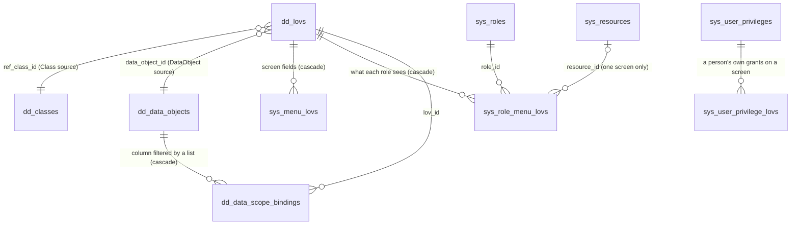

# 2. Apps Control — Lists of values (LOVs)

← [1. Classes and domains](01-apps-control-data-dictionary.md) · [Handover index](README.md) · next: 3. Menus

## 2.1 What it is

A **list of values** is a named source of choices (`REGIONS`, `MY_BRANCHES`, `ACTIVE_SERVICES`) that every dropdown in
the system can use by its code, plus the **rule of which values each role may see**. The same rule then filters more
than dropdowns: with a *data scope* it also limits the rows of a table a user can read (lists, inboxes, reports).

Two jobs in one object:

1. **Feed dropdowns** — a service question, a class attribute of type *list of values*, a report filter, a connected
   app's field, a partner's API call all ask `GET /lovs/{code}/values` and get value + Arabic + English labels (+ parent
   for cascading lists).
2. **Restrict data per role** — a *grant* says which values a role may see (all, some, by a rule over the user, none).
   Every read of the list applies it; a *data scope binding* applies the same grant to a column of a table.

Where the values come from (`source_type`):

| Source | Values come from | Typical use |
|---|---|---|
| `Class` | The active, in-date values of a class (part 1), for the user's company | Regions, sectors, grades |
| `DataObject` | A registered table or view (value / label / parent columns) | Companies, branches, services |
| `Query` | The **visual query builder**: a source (data object or class view), joins, filters, sort, value/label mapping | "Branches of my company", "services of the selected category" |
| `Sql` | Restricted SQL run on a separate read-only database role | Legacy queries pasted as they are (off unless configured) |
| `Integration` | — | Declared but not implemented: saving one is refused (see review points) |

## 2.2 Tables (schema `apps`)

Table and column names follow the legacy Apps Control ([legacy mapping](legacy-apps-control-mapping.md)).

### `apps.dd_lovs` — the lists (entity `Lov`)

| Column | Type | Meaning |
|---|---|---|
| `id`, `lov_code`, `lov_desc_ntv`, `lov_desc_frn`, `is_active`, `owner`, `instid`, `business_app`, `shared_apps`, audit, `xmin` | | Common configuration columns (see part 1) |
| `source_type` | text | `Class`, `DataObject`, `Query`, `Sql`, `Integration` |
| `ref_class_id` | uuid FK → `dd_classes` | `Class` source |
| `data_object_id` | uuid FK → `dd_data_objects` | `DataObject` source |
| `query` | jsonb | `Query` source: the builder's definition (`LovQueryDefinition`: from, joins, map, where, sort, distinct) |
| `sqlstmt` | text | `Sql` source (max 8000 chars) |
| `value_field`, `display_ar_column`, `display_en_column`, `parent_column` | varchar(63) | `DataObject` / `Sql`: which columns hold the value, the labels and the parent (cascading) |
| `static_filter` | jsonb | `Class` source only: JSONLogic over each value (`attributes`, `code`, `parent`) — e.g. only sectors with `IS_CONSTRUCTION = true` |
| `integration_operation_code` | varchar(100) | `Integration` source (not implemented) |
| `search_mode` | text | `Full` (send the whole list, up to `max_rows`) or `Typeahead` (pages of 50 as the user types) |
| `max_rows` | int | Upper bound of one read (1…limit) |
| `default_selection_mode` | text | `Single` / `Multi` — stored, not used by any screen (see review points) |
| `requires_grant` | bool | **Closed list:** a user without any grant sees nothing (otherwise: everything) |
| `is_public` | bool | Served by the external host (portal, partners) |

### `apps.sys_role_menu_lovs` — what a role may see (entity `LovGrant`)

| Column | Type | Meaning |
|---|---|---|
| `role_id` | uuid FK → `sys_roles` | The role |
| `lov_id` | uuid FK → `dd_lovs`, cascade | The list |
| `resource_id` | uuid FK → `sys_resources`, nullable | Empty: the role's grant everywhere; set: an override for **one screen** (wins over the general one on that screen) |
| `cmp_num` | varchar(100), nullable | Empty: the role's own grant; set: the grant of the role when held in that company (role company override) |
| `grant_type` | text | `All`, `Values`, `Rule`, `None` |
| `value_codes` | text[] | `Values`: the codes allowed |
| `rule` | jsonb | `Rule`: JSONLogic over the user context (`company`, `app`, `user.orgUnit(s)`, `user.positions`, `user.orgUnitAttributes`…) returning a value, a list, `true` (all) or `false`/null (none) — e.g. `{"var":"user.orgUnitAttributes.REGION"}` |
| `default_value_code` | varchar(200) | Pre-selected value for this role |

Unique per (`role_id, lov_id, resource_id, cmp_num`). These rows are **not edited as their own type**: they are
part of the role's payload (`apps.role` → `grants`), so a role and its data permissions move together in packages.

### `apps.sys_user_privilege_lovs` — a person's own grants (entity `UserPrivilegeGrant`)

A personal privilege on a screen (part "Users") can carry grants on lists for that screen only: `user_privilege_id`,
`lov_id`, `grant_type`, `value_codes` (text[]). They **only add** to what the person's roles give, within the
privilege's dates.

### `apps.sys_menu_lovs` — list ↔ screen field (entity `LovBinding`)

`lov_id`, `resource_id`, `field_code` (unique per resource + field), `selection_mode`. Saved with the list; **no runtime
code reads it** (see review points).

### `apps.dd_data_objects` and `apps.dd_data_scope_bindings` — registered tables and their row filters

| Table | Columns | Meaning |
|---|---|---|
| `dd_data_objects` | common columns (`object_code`, `object_desc_ntv/frn`…) + `db_schema`, `db_object` (varchar 63), `object_type` (`Table`/`View`), `columns` (jsonb: `name`, `dataType`, `labelAr/En`, `filterable`, `searchable`) | A table or view of a module schema (`AppsControl:DataObjectSchemas`) that lists, the query builder and reports may read. Only registered columns can be used |
| `dd_data_scope_bindings` | `data_object_id` (cascade), `value_field` (the column filtered), `lov_id`, `applies_to` (text[] of resource codes; empty = everywhere) | "Filter column `branch_code` of this table by the user's grant on list `MY_BRANCHES`" — applied by every query-builder read of the table (query lists, reports, public API read endpoints) |

## 2.3 The code, mapped to your layers

| Your layer | File | What it does |
|---|---|---|
| **Domain** | `src/Modules/AppsControl/Domain/Lovs.cs` | `Lov`, `LovGrant`, `LovBinding`, `DataObject`, `DataObjectColumn`, `DataScopeBinding`; enums `LovSourceType`, `SelectionMode`, `LovSearchMode`, `GrantType`, `DataObjectType`. `UserPrivilegeGrant` in `Domain/Users.cs` |
| **Application** (DTOs) | `Changes/LovAppliers.cs` | `LovPayload` (+ `LovBindingPayload`), `DataObjectPayload` (+ column and scope-binding payloads) |
| | `Lovs/LovModels.cs` | Runtime DTOs: `LovItem` (value, labels, parent), `LovPage`, `LovQuery` (parent, search, page, size, resource), `GrantSet`, `DataScopeFilter`, `LovRoleGrant` |
| | `Lovs/LovQueryDefinition.cs` | The query builder's definition (sources, joins, map, conditions, sort) |
| | `Changes/SecurityAppliers.cs` | `GrantPayload` inside `RolePayload.Grants` (and `UserGrantPayload` for personal grants) |
| (Contract for other modules) | `src/Shared/Platform/Lovs/ILovValidator.cs` | `IsAllowedAsync(lov, value, parent)`: "may this user pick this value?" |
| **DataAccess** | `Persistence/AppsControlDbContext.cs` | `Lovs`, `LovBindings`, `LovGrants`, `DataObjects`, `DataScopeBindings` and their mapping |
| **Repository** | — | None (EF directly) |
| **Business** — save | `Changes/LovAppliers.cs` → `LovApplier` | Per source: class / data object exists; SQL allowed on this installation and checked by the runner (columns, read-only); query checked against the registered sources (and registers the tables it reads when saved); static filter only for class lists and valid JSONLogic; `max_rows` limits; bindings |
| | `Changes/LovAppliers.cs` → `DataObjectApplier` | Schema allowed, object exists, columns exist (types read from the database), scope bindings |
| | `Changes/SecurityAppliers.cs` → `RoleApplier` | Saves the role with its list grants (and screen / company overrides) |
| **Business** — read | `Lovs/LovService.cs` | `GetValuesAsync`: loads the list, resolves the user's grant, returns nothing for an empty grant, reads the source with the grant, search, parent and paging, adds the default value. Also `ForCompany` (values of the user's company) and `DataScopeService` (row filters for a data object) |
| | `Lovs/GrantResolver.cs` | The grant rule: per held role the screen override wins over the general grant; roles held in a company use that company's override; results are **unioned** across roles; personal grants add; no grant at all → everything, or nothing when `requires_grant` |
| | `Lovs/LovQueryService.cs`, `LovQueryCompiler.cs` | The visual query builder: sources (data objects, class views `v_class_*`, other module tables), checks, preview, and safe SQL (registered columns only, every value a bound parameter, read-only transaction with a timeout, data scopes applied). Also runs reports (`ReportQueries.cs`) and public API reads (`DataQueries.cs`) |
| | `Lovs/SqlLovRunner.cs` | Restricted SQL: separate read-only database role (`AppsControl:…` connection string; empty = disabled), read-only transaction, statement timeout, parameters `@user_id`, `@username`, `@org_unit`, `@app` |
| | `Lovs/LovValidator.cs` | Implements `ILovValidator` by asking `LovService` with the user's grants (public lists only on the external host) |
| | `Lovs/DatabaseCatalog.cs` | Reads table / column metadata from PostgreSQL for data objects and the builder |
| **WebAPI** | `Endpoints/PublicEndpoints.cs` | `GET /lovs/{code}/values?parent=&q=&page=&size=&resource=` on both hosts (external: public lists only) |
| | `Endpoints/MeEndpoints.cs` | `GET /me/grants?lov=&resource=` — the signed-in user's effective grant (screens use it to hide or pre-fill) |
| | `Endpoints/AdminEndpoints.cs` | `GET /admin/lovs/{code}/values` and `/options` (every value, for administrators choosing what to grant), `GET /admin/lov-builder/sources`, `POST /admin/lov-builder/preview`, `GET /admin/lov-builder/grants/{code}`; generic `GET /admin/apps.lov…` and the change-set writes |
| | `Endpoints/ConnectEndpoints.cs` | Connected apps: `/lovs/{code}/values` and `/lovs/{code}/grant` with their users' tokens |
| **Angular (internal)** | `apps-control/config/config-types.ts` (section `lovs`) | The Lists of values and Data objects screens (generic config editor) |
| | `apps-control/lovs/lov-builder.ts` (+ `.html`, model, preview) | The visual query builder dialog (steps Get / Join / Map / Filter / Sort / Access), live preview with the SQL, and the *Access* step that edits each role's grant (saved on the roles) |
| | `apps-control/roles/screen-data.ts` | Role editor: data permissions per screen (screen overrides of list grants) |
| **Angular (shared lib)** | `apps-control/apps-control.api.ts` | `lovValues()`, `lovOptions()`, `lovBuilderSources()`, `lovBuilderPreview()`, grants |
| | `forms/lov-source.ts`, `apps-control/lov-source.ts` | `LOV_SOURCE` token: the dynamic form (portal and internal) asks it for a field's options; each app provides it from the API (`provideLovSource()` in `app.config.ts`) |
| **Tests** | `tests/AppsControl.Tests/LovTests.cs`, `LovQueryBuilderTests.cs`, `DataQueryTests.cs`, `ReportQueryTests.cs` | Sources, grants (roles, overrides, rules, companies, personal), paging, builder, data scopes |

## 2.4 What happens when a dropdown loads (end to end)

Example: the portal form's *Region* question uses list `REGIONS` (class source, public).

1. **Angular** — `dynamic-form` asks `LOV_SOURCE.options('REGIONS', parent)` → `AppsControlApi.lovValues()` →
   `GET /api/apps-control/v1/lovs/REGIONS/values` on the external host.
2. **Endpoint** — `PublicEndpoints.cs` builds the user's `AccessSnapshot` (`AccessResolver`) and calls
   `LovService.GetValuesAsync(code, access, query, publicOnly: true)`.
3. **Business** — `LovService` loads the list (active, and public on the external host, else *not found*);
   `GrantResolver.ResolveAsync` computes the grant (roles, screen and company overrides, personal grants, closed
   list); an empty grant returns an empty page at once.
4. **Business** — reads the source with the grant applied: class values of the user's company, active and in date,
   static filter, parent and search; or the data object / query / SQL with the grant as a `WHERE value IN (…)`.
   Paging fetches one extra row to say whether more exist. Adds the default value (the grant's, or the class's default)
   if the user may see it.
5. **Angular** — gets `{ items: [{ value, labelAr, labelEn, parent }], defaultValue, hasMore }` and shows the labels in
   the user's language.
6. **On submit** — Services' `FormValidator` calls `ILovValidator.IsAllowedAsync('REGIONS', value)`, which runs the
   same read for that value: a tampered request cannot submit a value the user could not pick.

Saving a list is the usual change-set flow from part 1 with entity type `apps.lov` and `LovApplier`. Saving grants is
an update of the role (`apps.role`) — the builder's *Access* step does it for you.

## 2.5 How the other parts use lists of values

| Who | How |
|---|---|
| **Services** | Questions of type choice can take their answers from a list (`question.lov`); the portal form loads them through `LOV_SOURCE`; submission checks them with `ILovValidator` |
| **Classes and domains** | Attributes of type *list of values* (`LovRef`) offer and check list values |
| **Reports and dashboards** | Report filters of type *list of values*; report queries are built with the same query builder and obey data scopes |
| **Public API** | The `LOOKUPS` function returns public lists; *read data* endpoints use the query builder (data scopes apply to the API client's service account) |
| **Connected apps** | Read list values and their user's grant through `ConnectEndpoints` |
| **Roles and users** | Roles carry grants (general, per screen, per company); personal privileges add grants on one screen |
| **Logic Builder, matrix designer** | Offer list values as choices when writing rules (`logic-fields.ts`, `matrix-references.ts`) |

## 2.6 Recipes

**A dropdown of a class** — Lists of values → New, source *Class*, pick the class; tick *Public* if the portal uses it.

**"Only the branches of my company"** — source *Query* in the builder: Get `apps.sys_company_branches` (data object), Filter
`cmp_num = the user's company` (conditions can compare with the user's data), Map value/labels. Or keep a plain
list and give roles a grant of type *Rule* over the user context — `company`, `app`, `user.orgUnit`, `user.orgUnits`,
`user.positions`, `user.orgUnitAttributes.REGION` … (e.g. `{"var": "user.orgUnitAttributes.REGION"}`).

**Limit a table per role** — register the table as a data object, add a scope binding *column → list*, and give each
role a grant on that list. Every query-builder read (lists, reports, API) is filtered.

## 2.7 Things to know

- **No grant means everything** unless the list is closed (`requires_grant`). Close lists that hold sensitive values.
- **Roles add up.** A user with two roles sees the union of their grants; a screen override replaces the general grant
  of that role on that screen only.
- **The external host serves only public lists**, whatever the caller's roles.
- **Query lists are safe SQL**: only registered columns, bound parameters, read-only, with a timeout. Restricted SQL is
  powerful but runs on a separate read-only role and is off by default.
- **Class lists respect companies** (classes with values per company) and dates (effective from/to).

## 2.8 Review points (for the owner)

| # | Finding | Proposal |
|---|---|---|
| 1 | `apps.sys_menu_lovs` (list ↔ screen field) is saved but **no runtime code reads it**: dropdowns name their list in their own definition (question, attribute, report filter). | Drop the table, `LovBinding`, the `bindings` payload field and its form fields (one migration). |
| 2 | Source type `Integration` (and column `integration_operation_code`) is declared but saving it is refused ("becomes available with the Integration Manager"); lists from an operation's results are not built. | Remove the option and the column now; add it back as a real feature if needed (lists filled by an Integration Manager operation). |
| 3 | `default_selection_mode` (`Single`/`Multi`) is stored and edited but nothing reads it: each field decides single or multiple itself. | Drop the column and the field. |
| 4 | `search_mode` + `max_rows` both control page size; *Typeahead* pages by 50, *Full* sends up to `max_rows`. | Keep (works), but rename on screen to *Load all values* / *Search as you type* so the effect is clear. |
