# دليل مستخدم النظام الداخلي

**ديناميك كيوب — منصة الخدمات الحكومية** — الإصدار 1.0 — أكتوبر 2026

> هذا الملف مولّد من `docs/manual/manual-content.js` بالأمر `node docs/manual/build-manual.js`، ومعه نسخة Word: [user-manual-ar.docx](user-manual-ar.docx).

## المحتويات

- [مقدمة](#مقدمة)
- [1. الدخول والواجهة](#1-الدخول-والواجهة)
- [2. مركز الإجراءات](#2-مركز-الإجراءات)
- [3. الطلبات](#3-الطلبات)
- [4. سجل المتعاملين](#4-سجل-المتعاملين)
- [5. المستندات والمدفوعات والزيارات والرسائل](#5-المستندات-والمدفوعات-والزيارات-والرسائل)
- [6. مفاهيم الإعداد](#6-مفاهيم-الإعداد)
- [7. إعداد الخدمات](#7-إعداد-الخدمات)
- [8. مسارات العمل](#8-مسارات-العمل)
- [9. قواعد القرار](#9-قواعد-القرار)
- [10. المستندات](#10-المستندات)
- [11. التنبيهات والرسائل](#11-التنبيهات-والرسائل)
- [12. المدفوعات](#12-المدفوعات)
- [13. الزيارات الميدانية](#13-الزيارات-الميدانية)
- [14. محتوى البوابة](#14-محتوى-البوابة)
- [15. التكاملات](#15-التكاملات)
- [16. التحكم بالتطبيقات](#16-التحكم-بالتطبيقات)
- [17. أسئلة شائعة](#17-أسئلة-شائعة)
- [مسرد المصطلحات](#مسرد-المصطلحات)

## مقدمة

يشرح هذا الدليل استخدام النظام الداخلي لمنصة ديناميك كيوب للموظفين: معالجة الطلبات من مركز الإجراءات، ومتابعة الطلبات والمتعاملين والمستندات، وإعداد الخدمات ومسارات العمل والتنبيهات والصلاحيات دون برمجة.

الدليل موجه إلى ثلاث فئات:

- موظفو المعالجة: يستلمون المهام ويتخذون الإجراءات على الطلبات (الفصول 2 إلى 5).
- المشرفون: يوزعون المهام ويتابعون التأخير والتفويض (الفصل 2).
- مسؤولو الإعداد: يضيفون الخدمات ومسارات العمل والقواعد والقوائم والصلاحيات (الفصول 6 إلى 16).

> **ملاحظة:** لا تظهر لكل موظف إلا الشاشات والإجراءات التي تمنحها له أدواره؛ لذلك قد تختلف قائمتك عما في الصور.

## 1. الدخول والواجهة

### 1.1 تسجيل الدخول

افتح رابط النظام الداخلي، وأدخل اسم المستخدم وكلمة المرور، ثم اضغط «تسجيل الدخول». إذا كانت جهتك تستخدم الدخول الموحد فستنتقل إلى صفحة الجهة مباشرة.

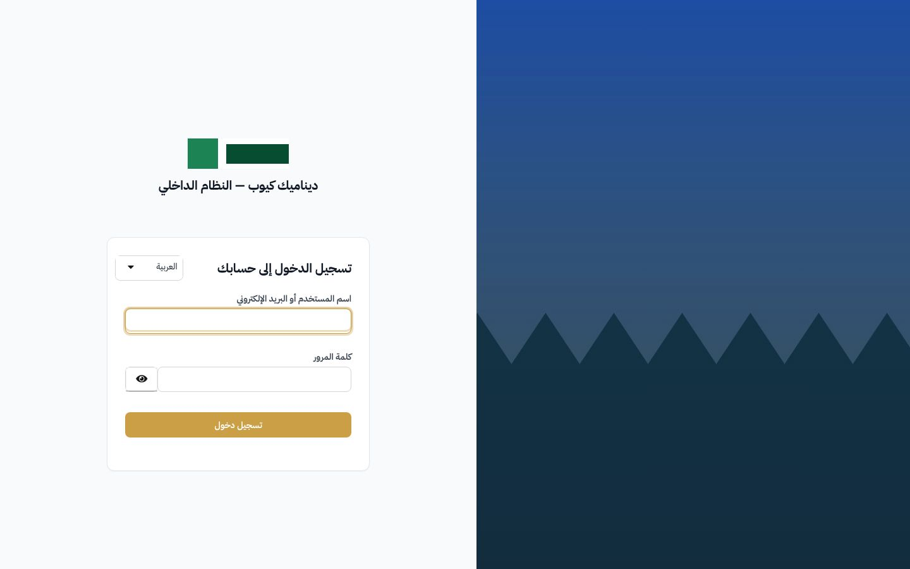

*صفحة تسجيل الدخول*

### 1.2 مكونات الواجهة

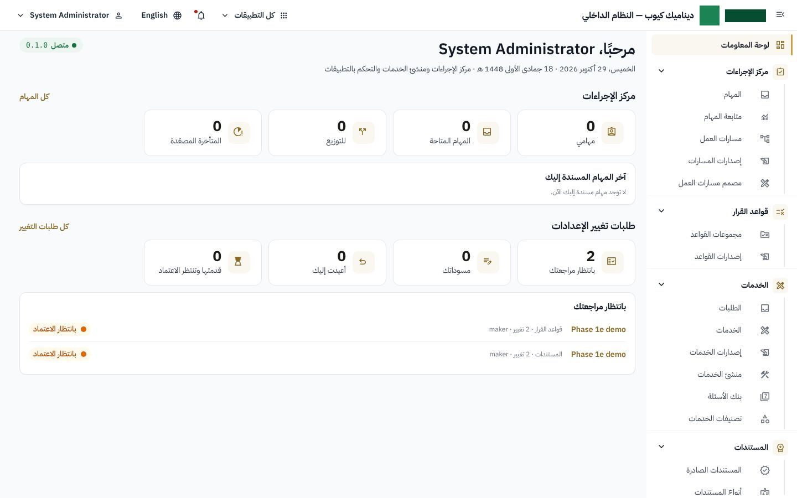

*لوحة المعلومات والقائمة الجانبية*

- القائمة الجانبية: مجموعات (مثل «مركز الإجراءات» و«الخدمات») تحت كل منها شاشاتها. اضغط سهم المجموعة لطيها أو فتحها، وزر القائمة أعلى الصفحة لإخفائها.
- مسار التنقل أعلى كل شاشة يبين مكانك ويعيدك إلى ما قبلها.
- الشريط العلوي: اختيار تطبيق الأعمال، والإشعارات (الجرس)، وتبديل اللغة بين العربية والإنجليزية، وقائمة المستخدم للخروج.

### 1.3 تطبيقات الأعمال

قد تدير الجهة عدة خطوط أعمال (مثل التصنيف أو التصاريح أو الخدمات الميدانية)، ولكل منها خدماته وموظفوه. اختر التطبيق من الشريط العلوي فتقتصر القوائم والطلبات والمهام عليه، أو اختر «كل التطبيقات» لعرض كل ما يسمح به دورك.

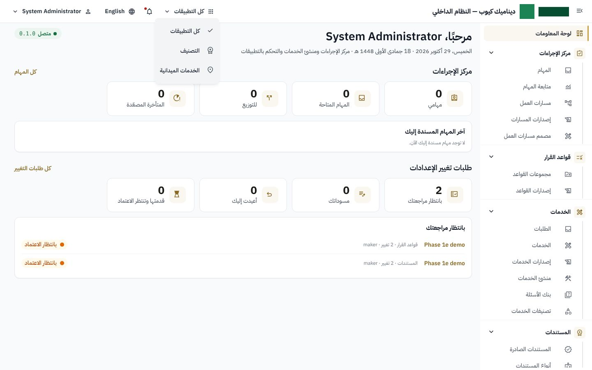

*اختيار تطبيق الأعمال*

## 2. مركز الإجراءات

مركز الإجراءات هو مكان العمل اليومي: كل خطوة في مسار طلب تحتاج إلى موظف تظهر هنا مهمةً.

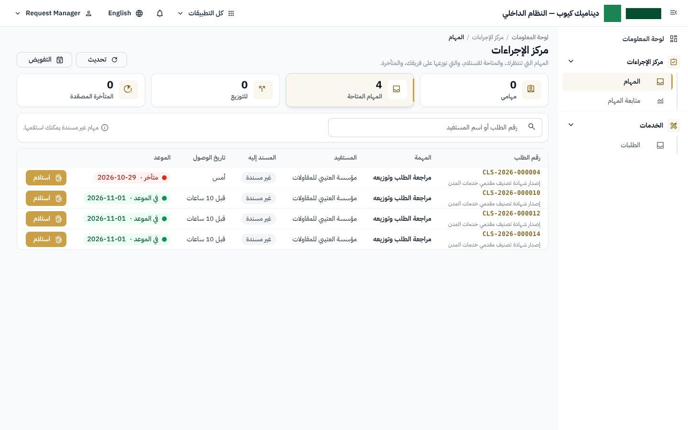

*مركز الإجراءات*

### 2.1 صناديق المهام

| الصندوق | ما يحويه |
| --- | --- |
| مهامي | المهام المسندة إليك أو إلى من تنوب عنه. |
| المهام المتاحة | مهام متاحة لدورك أو وحدتك؛ يستلمها أول من يضغط «استلام». |
| للتوزيع | مهام ينتظر فريقك أن توزعها عليهم (للموزعين والمشرفين). |
| المتأخرة المصعّدة | مهام تجاوزت موعدها وصُعّدت إلى دورك. |

ابحث برقم الطلب أو اسم المستفيد، وراقب عمود «الموعد»: الأحمر متأخر، والبرتقالي يقترب من موعده.

### 2.2 العمل على مهمة

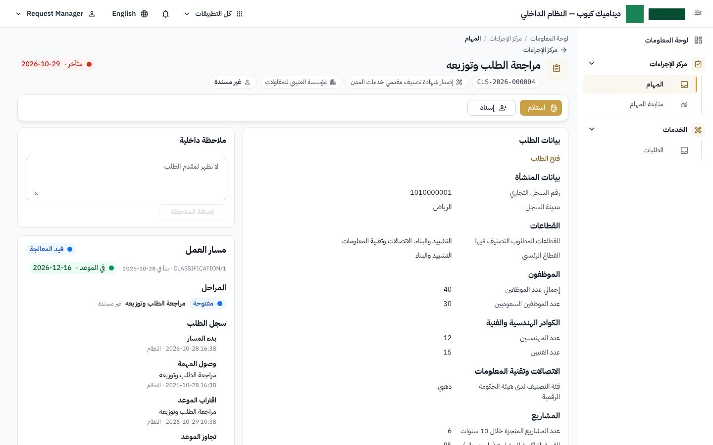

*صفحة المهمة*

1. افتح المهمة من القائمة. تعرض الصفحة بيانات الطلب كما قدمها المستفيد، ومسار العمل ومراحله، وسجل الطلب.
2. اضغط «استلام» لتصبح المهمة لك (أو «إسناد» إن كنت موزعًا لاختيار الموظف).
3. راجع البيانات والمرفقات، وأضف «ملاحظة داخلية» عند الحاجة؛ لا تظهر الملاحظات لمقدم الطلب.
4. اختر الإجراء المناسب (مثل «إحالة» أو «اعتماد» أو «رفض» أو «إعادة للمستفيد»). يطلب بعض الإجراءات تعليقًا أو بيانات إضافية.
5. ينتقل الطلب إلى الخطوة التالية في مساره، ويُشعَر المستفيد إن كان ذلك مُعدًّا.

> **ملاحظة:** «إعادة للمستفيد» تعيد الطلب إلى البوابة ليعدله مقدم الطلب ثم يعيد إرساله، فيرجع إلى الخطوة نفسها.

### 2.3 التفويض

اضغط «التفويض» في مركز الإجراءات لتحديد موظف ينوب عنك في فترة غيابك؛ تظهر مهامك في صندوقه خلال تلك الفترة.

### 2.4 متابعة المهام (للمشرفين)

تعرض شاشة «متابعة المهام» المهام المفتوحة لكل الفريق مع أعمارها ومواعيدها، لإعادة الإسناد ومتابعة المتأخر.

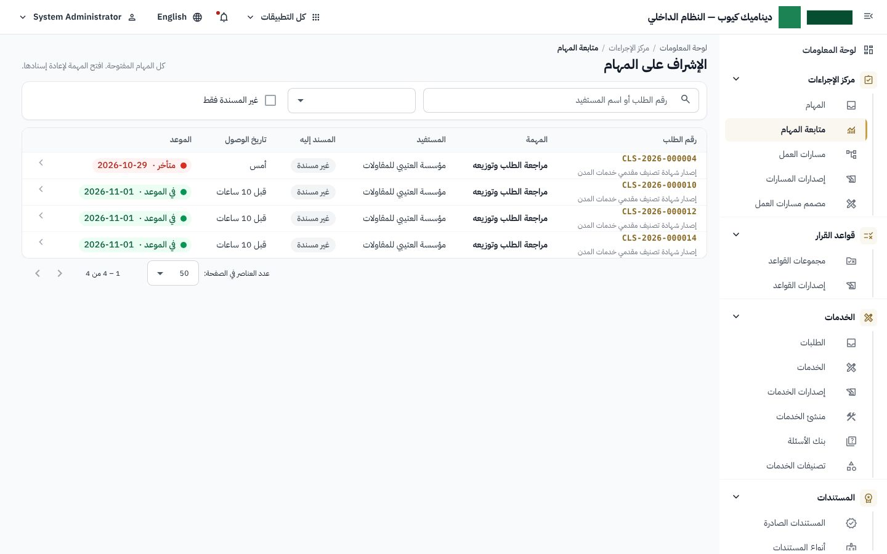

*متابعة المهام*

## 3. الطلبات

من «الخدمات ← الطلبات» ابحث عن أي طلب بالرقم أو اسم المستفيد، وصفِّ حسب الحالة.

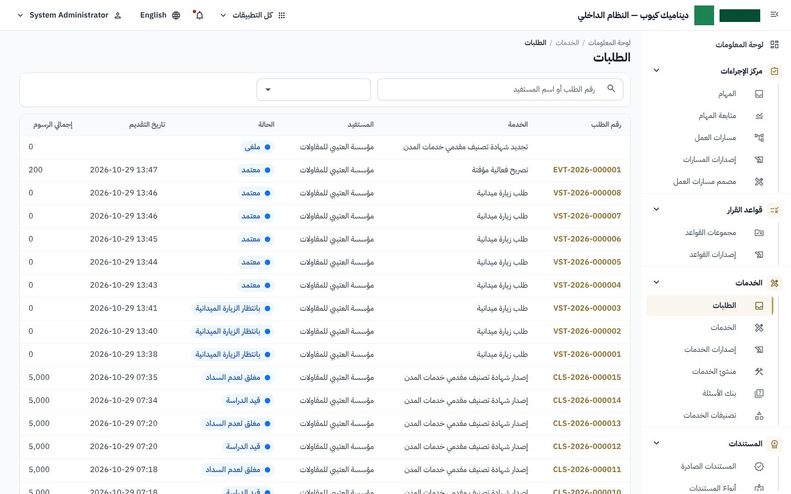

*قائمة الطلبات*

اضغط رقم الطلب لعرض تفاصيله:

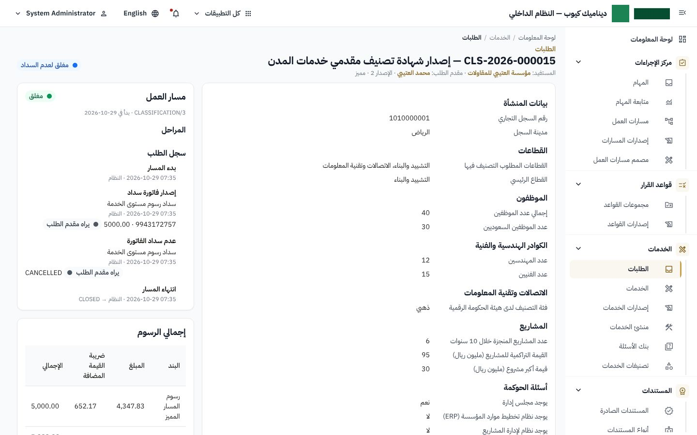

*تفاصيل الطلب*

- بيانات الطلب كما أدخلها المستفيد، مقسمة بأقسام النموذج.
- مسار العمل: الإصدار المستخدم، والمراحل المفتوحة، وسجل الأحداث (وصول المهام، الإجراءات، الفواتير، الزيارات…).
- إجمالي الرسوم: البنود والضريبة والإجمالي، وحالة الفاتورة.
- المستندات الصادرة على الطلب.

## 4. سجل المتعاملين

يجمع السجل الأفراد والمنشآت التي تتعامل مع الجهة، ويُحدَّث تلقائيًا من التكاملات (مثل السجل التجاري) عند دخولهم البوابة.

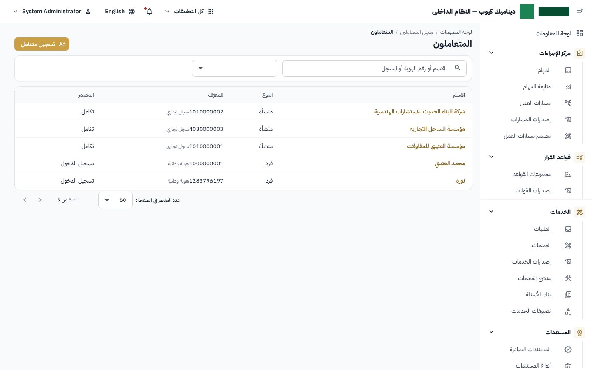

*قائمة المتعاملين*

### 4.1 ملف المتعامل

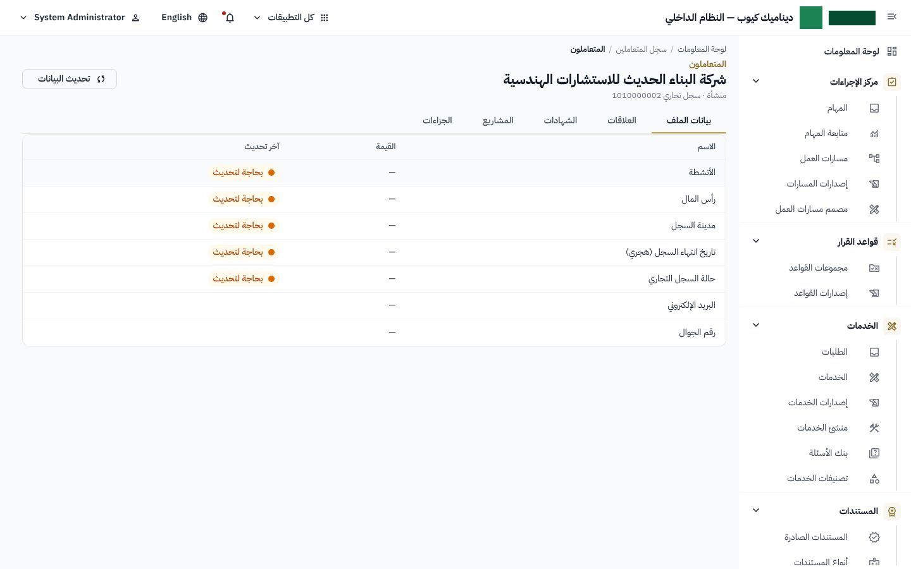

*ملف المتعامل*

- المعرفات: الهوية أو الإقامة أو السجل التجاري أو الرقم الموحد.
- العلاقات: من يمثل المنشأة (مالك، شريك، مدير، مفوض) وصلاحية التمثيل في البوابة. أضف مفوضًا يدويًا محددًا بخدمات وفترة.
- الشهادات والمشاريع: سجلات صادرة من جهات أخرى، مع تاريخ الانتهاء.
- الجزاءات: منع من التقديم لمدة؛ يرفعها موظف غير من سجلها.
- حساب البوابة: إنشاء حساب دخول للمستفيد برقم هويته وإرسال رابط تعيين كلمة المرور.

### 4.2 حسابات البوابة

من «التحكم بالتطبيقات ← حسابات البوابة» ابحث عن حسابات المستفيدين، وفعّلها أو أوقفها، وأعد تعيين كلمات مرورها. اسم الدخول هو رقم الهوية أو الإقامة.

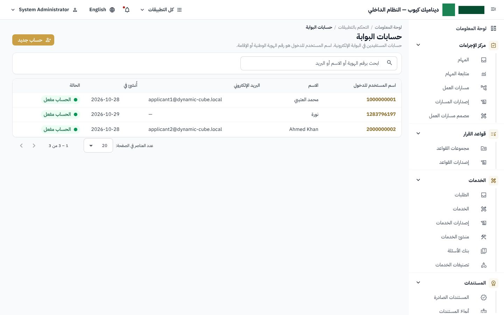

*حسابات البوابة*

## 5. المستندات والمدفوعات والزيارات والرسائل

### 5.1 المستندات الصادرة

تعرض شاشة «المستندات الصادرة» الشهادات والتراخيص التي أصدرتها مسارات العمل، مع حالتها وتاريخ انتهائها. يمكنك عرض المستند وطباعته، وتغيير حالته (إيقاف أو إلغاء) بحسب صلاحيتك. يتحقق أي شخص من المستند برمز QR.

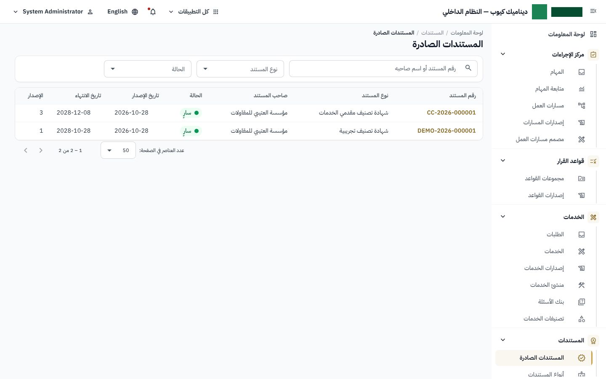

*المستندات الصادرة*

### 5.2 الفواتير

تعرض «المدفوعات ← الفواتير» فواتير سداد الطلبات وحالتها (بانتظار السداد، مسددة، منتهية، ملغاة).

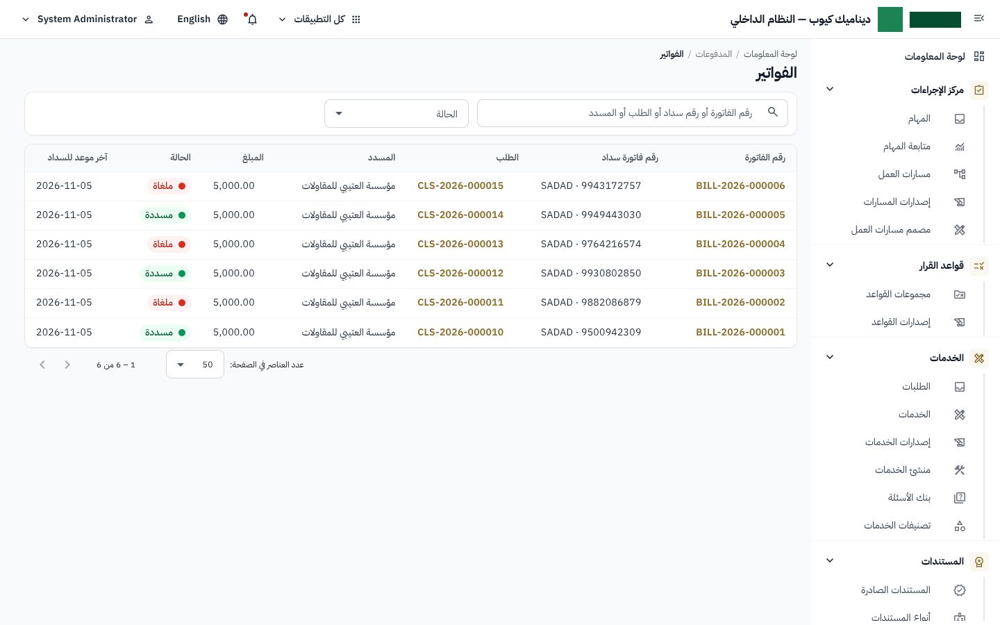

*الفواتير*

### 5.3 الزيارات الميدانية

تعرض «الزيارات» الزيارات المطلوبة من مسارات العمل: إسنادها إلى مفتش، وموعدها، ونتيجتها والصور والملاحظات. ينجز المفتش الزيارة من تطبيق الميدان ولو دون اتصال.

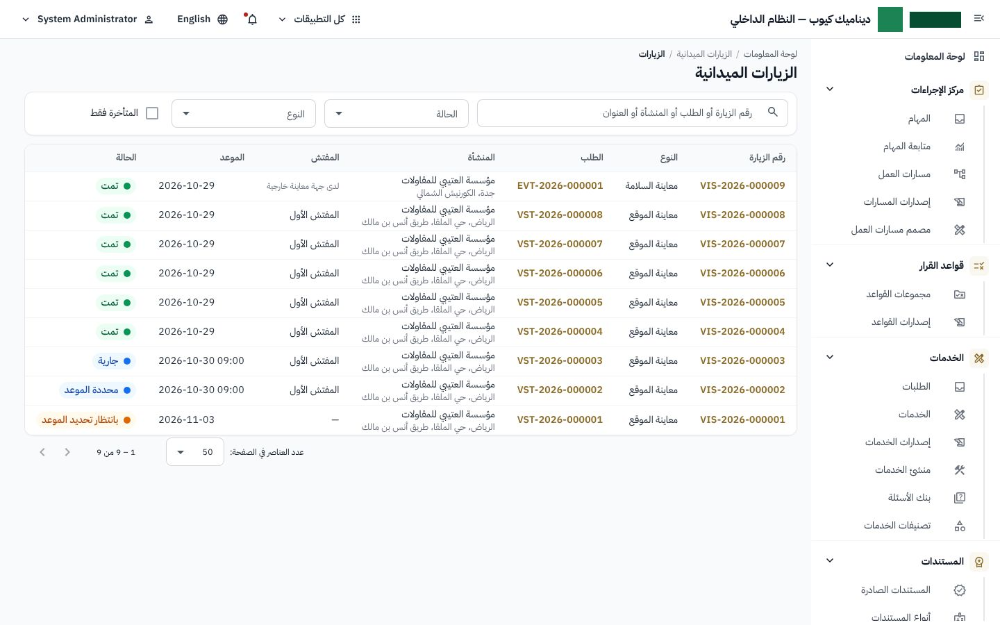

*الزيارات*

### 5.4 سجل الرسائل

يعرض «سجل الرسائل» كل بريد ورسالة نصية وإشعار أرسلته المنصة، مع حالة الإرسال وسبب الإخفاق إن وجد.

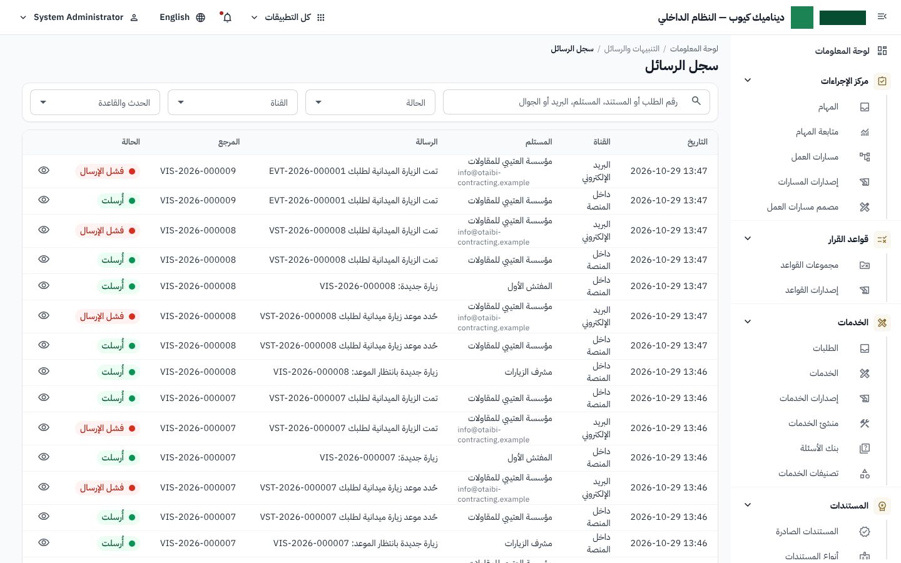

*سجل الرسائل*

## 6. مفاهيم الإعداد

كل شاشات الإعداد تعمل بالطريقة نفسها. افهم المفاهيم التالية مرة واحدة.

### 6.1 طلبات التغيير والاعتماد

لا يُطبَّق أي تعديل على الإعداد مباشرة في المجالات التي تتطلب اعتمادًا. يُضاف التعديل إلى «مسودتك» ثم يمر بهذه المراحل:

| المرحلة | من يقوم بها | ما يحدث |
| --- | --- | --- |
| مسودة | المُعِدّ | تجمع التعديلات؛ يمكن تعديلها أو حذف بنودها. |
| بانتظار الاعتماد | المُعِدّ بضغط «إرسال للاعتماد» | تُقفل المسودة وتنتظر المعتمد. |
| معتمد ثم منشور | المعتمد بضغط «اعتماد ونشر» | تُطبَّق كل البنود معًا، أو لا يُطبَّق شيء إن فشل أحدها. |
| مرفوض | المعتمد | تعود مع سبب الرفض. |

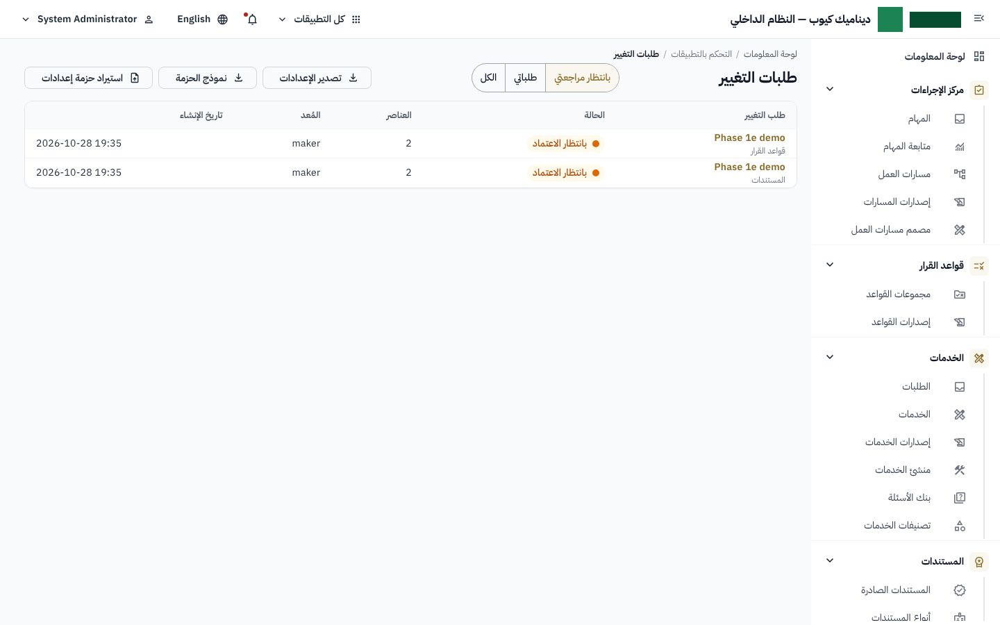

*طلبات التغيير*

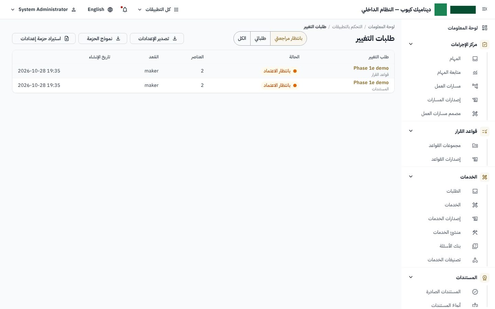

*تفاصيل طلب تغيير: كل بند مع قيمته قبل التعديل وبعده*

تحدد «سياسة الاعتماد» أي مجالات الإعداد تحتاج إلى اعتماد، وأيها يُحفظ مباشرة.

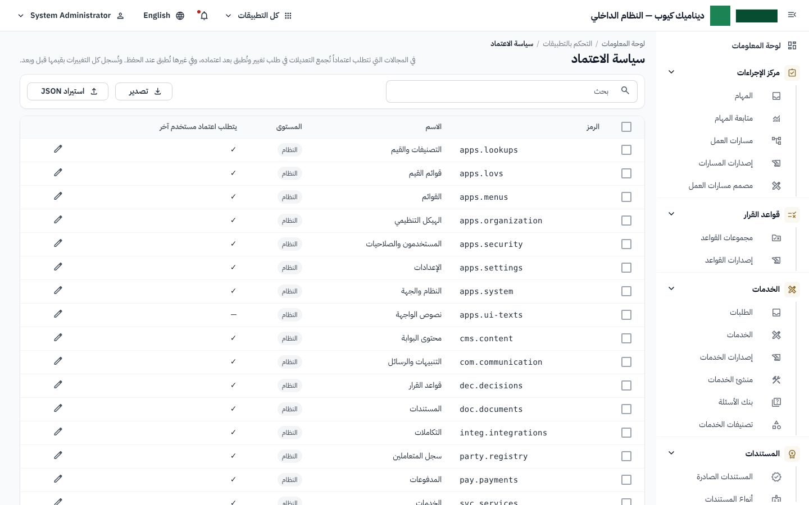

*سياسة الاعتماد*

> **ملاحظة:** لا يعتمد الموظف طلب تغيير أعدّه بنفسه.

### 6.2 نموذج التحرير

تُفتح السجلات في نموذج من ثلاثة أقسام: «البيانات الأساسية» (الرمز والاسمين والحالة)، و«التفاصيل» الخاصة بنوع السجل، و«المستوى».

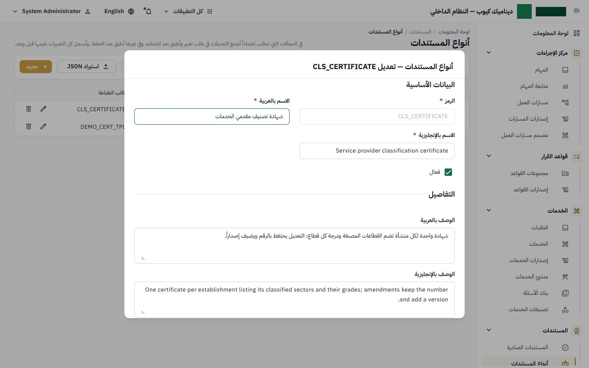

*نموذج تحرير سجل: الحقول المهيكلة على شكل جداول*

- الحقول المركبة (مثل حقول المستند أو مدخلات العملية) تُدخل في جداول: «إضافة صف»، وسهم لإعادة الترتيب، وسلة للحذف.
- لكل حقل مركب مفتاح «نموذج / JSON»؛ عرض JSON للمطلعين فقط أو للصق إعداد جاهز، ولا يلزم استخدامه.
- القواعد المكتوبة بصيغة JSONLogic (مثل `{"var": "task.assignee"}`) تُكتب في خانة «القاعدة» أو تُبنى في محرر القواعد المرئي حيث يتوفر.

### 6.3 المستويات

| المستوى | متى يُستخدم |
| --- | --- |
| النظام | إعداد يشترك فيه الجميع (بلا جهة ولا تطبيق). |
| الجهة | إعداد خاص بجهة حكومية واحدة. |
| التطبيق | إعداد خاص بتطبيق أعمال أو أكثر من تطبيقات الجهة نفسها (مثل نوع مستند يستخدمه تطبيقان). |

يرى الموظف صفوف تطبيقاته والصفوف المشتركة، ولا يعدّل صفًا مشتركًا بين عدة تطبيقات إلا إذا كانت كلها ضمن صلاحيته.

### 6.4 التصدير والاستيراد

من أي شاشة إعداد يمكن «تصدير» السجلات المختارة (مع ما تعتمد عليه) إلى ملف، و«استيراد JSON» إلى بيئة أخرى. تعرض نافذة المراجعة كل بند مع الفرق عن الموجود والأخطاء قبل الحفظ.

## 7. إعداد الخدمات

### 7.1 الخدمات

تعرض «الخدمات» كتالوج الخدمات: الرمز، والنمط (إصدار، تعديل، طلب زيارة، تصديق)، والتصنيف، والظهور في البوابة، وأنواع المتعاملين المسموح لهم.

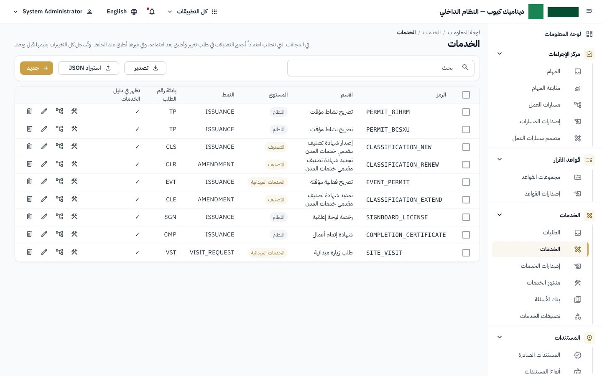

*الخدمات*

### 7.2 منشئ الخدمات

ينشئ «منشئ الخدمات» الإصدار التالي من الخدمة في تبويبات:

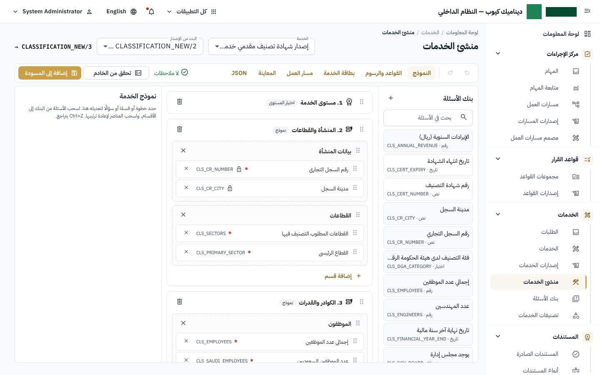

*منشئ الخدمات*

| التبويب | ما يُعد فيه |
| --- | --- |
| النموذج | خطوات النموذج وأقسامه وأسئلته؛ اسحب الأسئلة من بنك الأسئلة. يُحدد لكل سؤال الإلزام والظهور الشرطي. |
| القواعد والرسوم | الأهلية (من يحق له التقديم)، ومستويات الخدمة ومددها، والرسوم والشرائح والضريبة. |
| بطاقة الخدمة | ما يظهر في صفحة الخدمة بالبوابة: الوصف، والخطوات، والشروط، والمستندات المطلوبة، والقنوات. |
| مسار العمل | فتح مسار الخدمة في المصمم. |
| المعاينة | تجربة النموذج كما يراه المستفيد بالعربية والإنجليزية. |

اضغط «تحقق من الخادم» لفحص الإصدار، ثم «إضافة إلى المسودة» واعتمده من طلبات التغيير. لا يتغير إصدار منشور؛ كل تعديل إصدار جديد.

### 7.3 بنك الأسئلة

أسئلة يعاد استخدامها في الخدمات: نوع الإجابة (نص، رقم، تاريخ، اختيار، نعم/لا، رفع ملفات)، والخيارات أو قائمة القيم، والقيود (أقل وأعلى قيمة، أقصى طول، النمط)، والتعبئة المسبقة من ملف المتعامل.

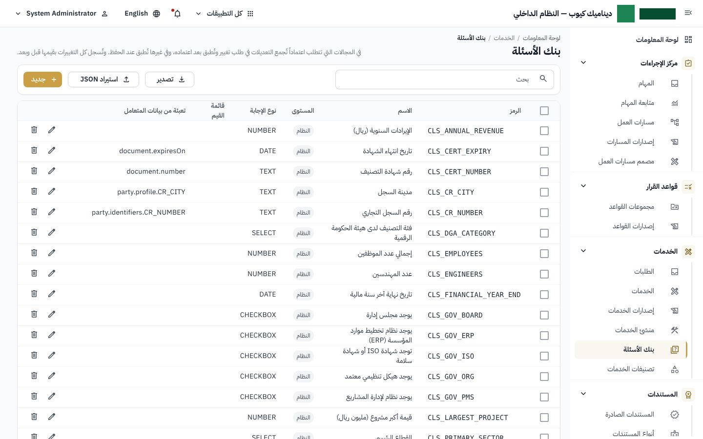

*بنك الأسئلة*

سؤال «رفع ملفات» يطلب من المتعامل إرفاق ملف: حدد أنواع الملفات المقبولة (مثل pdf, jpg؛ الفارغ للمستندات والصور المعتادة)، وأكبر حجم للملف (حتى 25 ميجابايت)، وفعّل «اختيار متعدد / عدة ملفات» مع أقصى عدد للملفات عند الحاجة لأكثر من ملف.

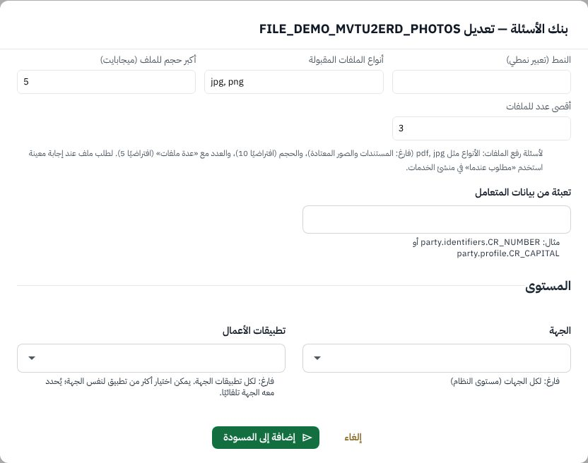

*إعدادات سؤال رفع الملفات*

لطلب ملف عند إجابة معينة فقط (مثل «هل لديك ترخيص سابق؟» = نعم): أضف سؤال الملف إلى النموذج في منشئ الخدمات واضبط له «مطلوب عندما» و«يظهر عندما» على تلك الإجابة. يرفع المتعامل الملفات في البوابة ويراها الموظف في تفاصيل الطلب وفي مهمة مركز الإجراءات ويفتحها بالضغط عليها.

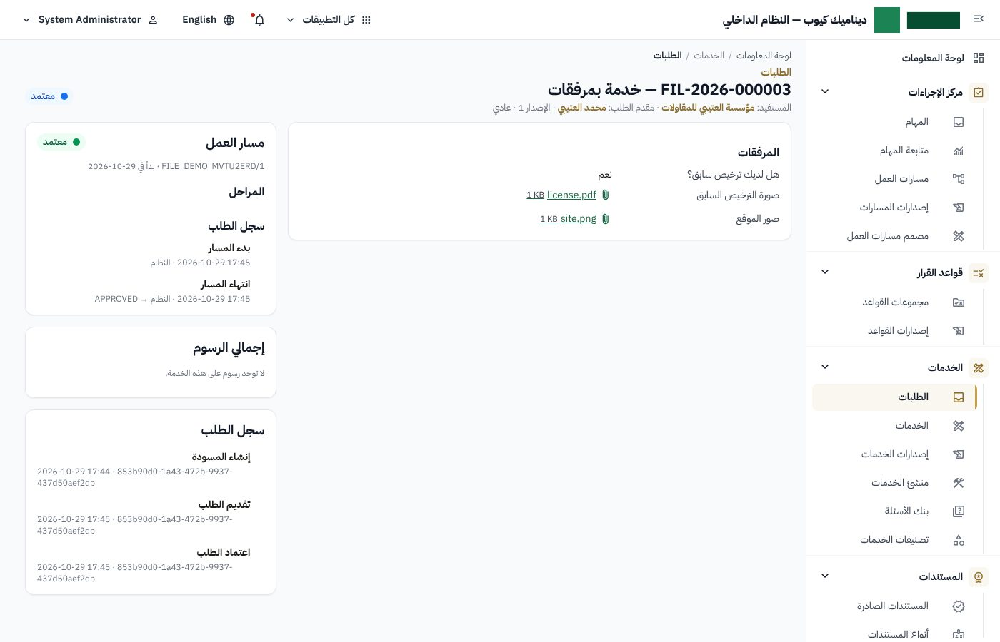

*ملفات الطلب في تفاصيل الطلب*

### 7.4 تصنيفات الخدمات

تجمع التصنيفات الخدمات في تبويبات الصفحة الرئيسية للبوابة وفي تصفية البحث. التصنيفات قيم في «التصنيفات والقيم» (الفئة SVC_CATEGORY) وتُعدّ من هذه الشاشة أيضًا.

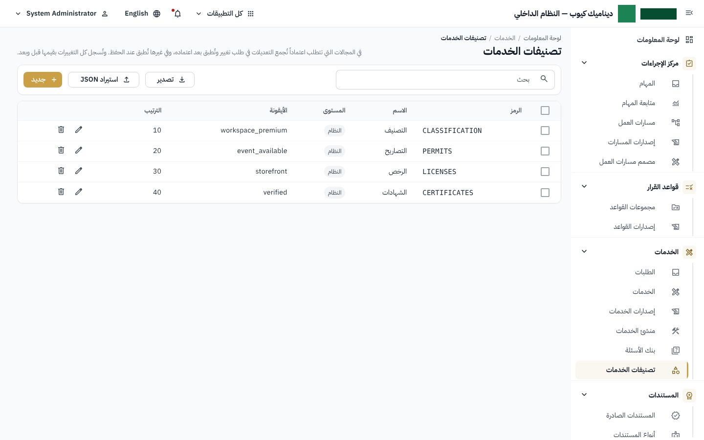

*تصنيفات الخدمات*

## 8. مسارات العمل

لكل خدمة مسار عمل يحدد خطوات معالجة الطلب. تعرض «مسارات العمل» المسارات و«إصدارات المسارات» إصداراتها.

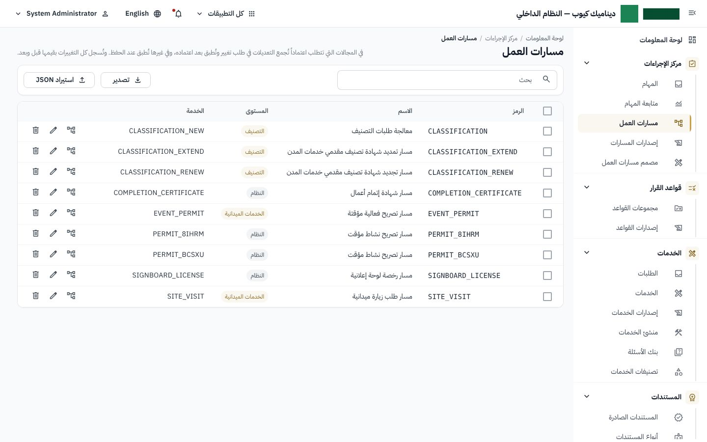

*مسارات العمل*

### 8.1 مصمم مسارات العمل

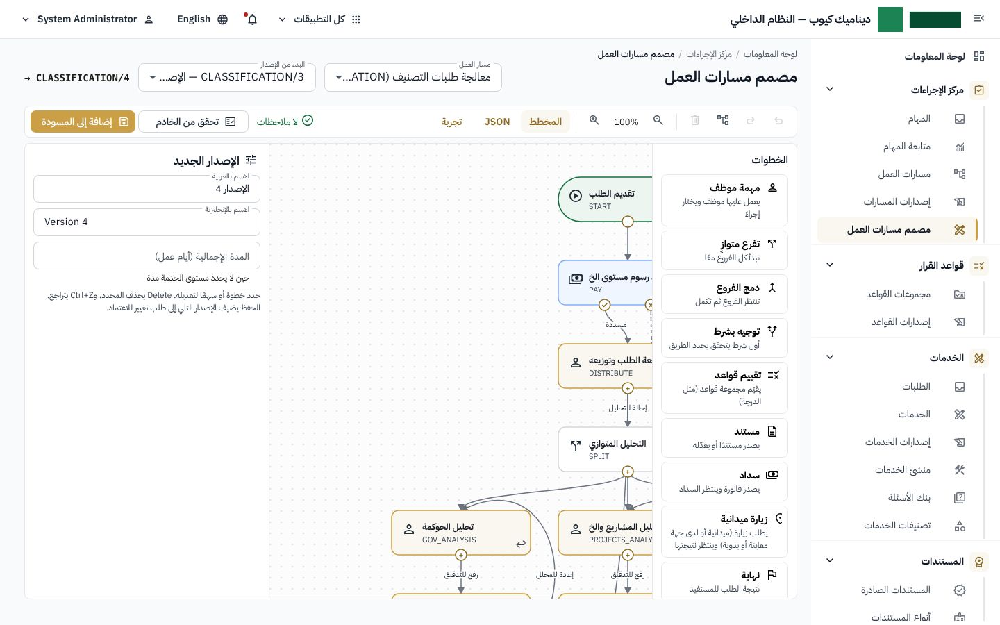

*مصمم مسارات العمل*

1. اختر المسار والإصدار الذي تبدأ منه.
2. اسحب الخطوات من لوحة «الخطوات» إلى المخطط: مهمة موظف، تفرع متوازٍ، دمج الفروع، توجيه بشرط، تقييم قواعد، مستند، سداد، زيارة ميدانية، نهاية.
3. اربط الخطوات بسحب السهم من نقطة الخطوة إلى التالية.
4. اختر خطوة لتعديلها في اللوحة الجانبية: الاسم، ومن يعمل عليها، وطريقة التوزيع، والإجراءات المتاحة، والمدة لكل مستوى خدمة.
5. جرّب المسار من «تجربة» بإجابات تجريبية، ثم «تحقق من الخادم» و«إضافة إلى المسودة».

#### من يعمل على المهمة

| الخيار | المعنى |
| --- | --- |
| من يحمل دورًا | كل من لديه الدور يرى المهمة. |
| موظف محدد | تسند إلى مستخدم بعينه. |
| من أنجز خطوة سابقة | تعود إلى من عمل على خطوة سابقة في الطلب نفسه. |
| حسب الهيكل التنظيمي | وحدة محددة أو وحدة يحددها شرط، أو وحدة نسبية (مثل الإدارة الأعلى من وحدة سابقة)، مع مسمى وظيفي اختياري (مثل مدير الإدارة). |

| طريقة التوزيع | المعنى |
| --- | --- |
| قائمة مشتركة | يستلمها أول موظف متاح. |
| يوزعها موزّع | يختار الموزع الموظف من صندوق «للتوزيع». |
| تلقائيًا | تسند إلى الأقل مهامًا. |

> **ملاحظة:** أسماء أنواع الخطوات وأيقوناتها تُعدّ في «التصنيفات والقيم» (الفئة WF_STEP_TYPE)، وإيقاف نوع يخفيه من المصمم.

## 9. قواعد القرار

مجموعات القواعد تحسب نتائج مثل درجة التصنيف من بيانات الطلب، وتستخدمها خطوة «تقييم قواعد» في المسار. لكل مجموعة إصدارات؛ يعمل الطلب بأحدث إصدار منشور.

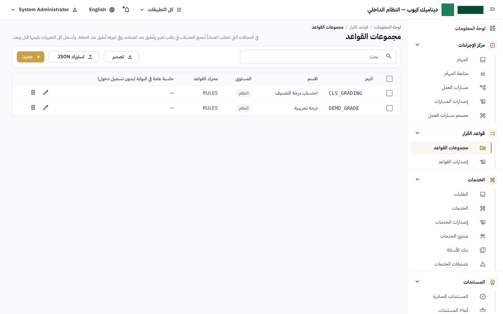

*مجموعات القواعد*

في «إصدارات القواعد» يُبنى الإصدار الجديد من: الخطوات (اسم وقاعدة لكل خطوة)، ونتيجة لكل عنصر (مثل كل قطاع)، والنتيجة النهائية. جرّب الإصدار بمدخلات تجريبية قبل إضافته.

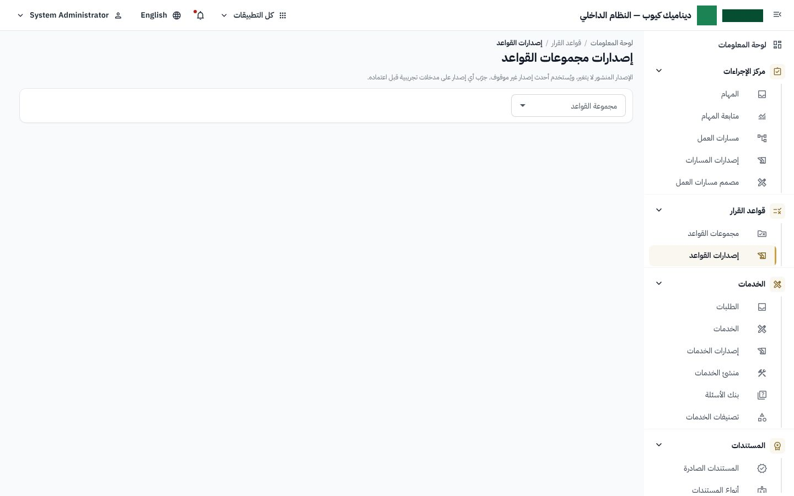

*إصدارات القواعد*

## 10. المستندات

### 10.1 أنواع المستندات

يحدد نوع المستند: بادئة الترقيم، ومدة الصلاحية، وأيام التذكير قبل الانتهاء، وحقول البيانات وحقول البنود (مع ما يظهر منها في صفحة التحقق العامة)، وقالب الطباعة.

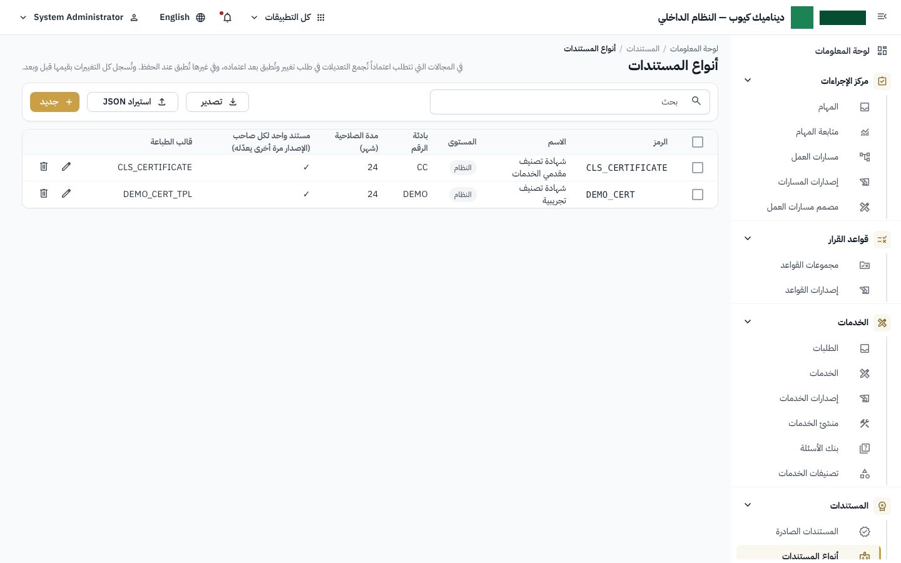

*أنواع المستندات*

### 10.2 قوالب الطباعة

قوالب الشهادات القابلة للطباعة مع معاينة مباشرة على بيانات تجريبية، وتحوَّل إلى PDF عند الإصدار.

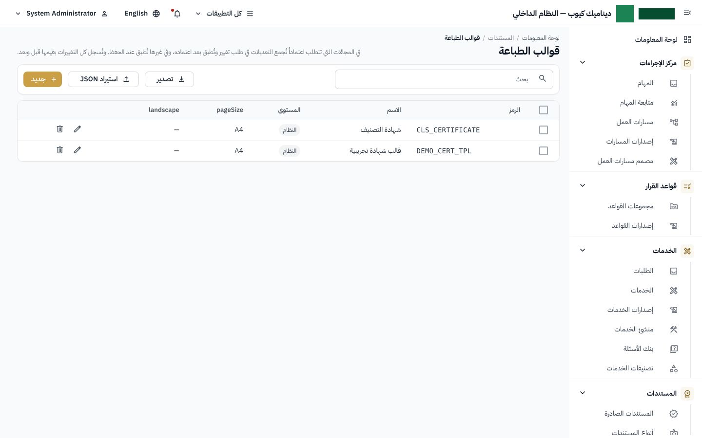

*قوالب الطباعة*

## 11. التنبيهات والرسائل

### 11.1 قواعد التنبيه

تربط القاعدة حدثًا (مثل اعتماد الطلب أو اقتراب انتهاء المستند) بقالب رسالة وقنوات (داخل المنصة، البريد، الرسائل النصية) ومستلمين (المتعامل، أو حاملو دور، أو موظف)، مع شرط اختياري.

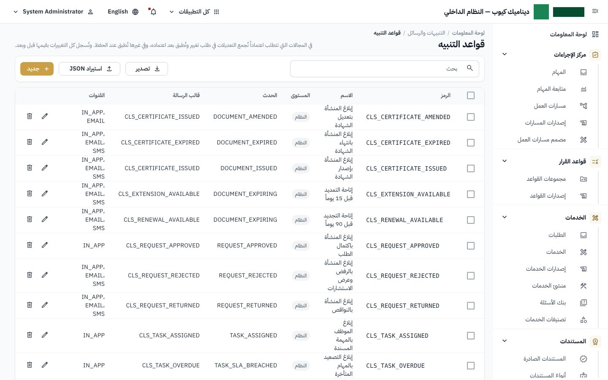

*قواعد التنبيه*

### 11.2 قوالب الرسائل

لكل قالب نص لكل قناة بالعربية والإنجليزية. يُكتب نص البريد في محرر نصوص منسقة (عناوين، غامق، قوائم، روابط، محاذاة) دون كتابة HTML، ويُدرج «إدراج حقل» قيم الطلب مثل رقمه واسم المستفيد. تظهر المعاينة مباشرة على بيانات حدث تجريبي.

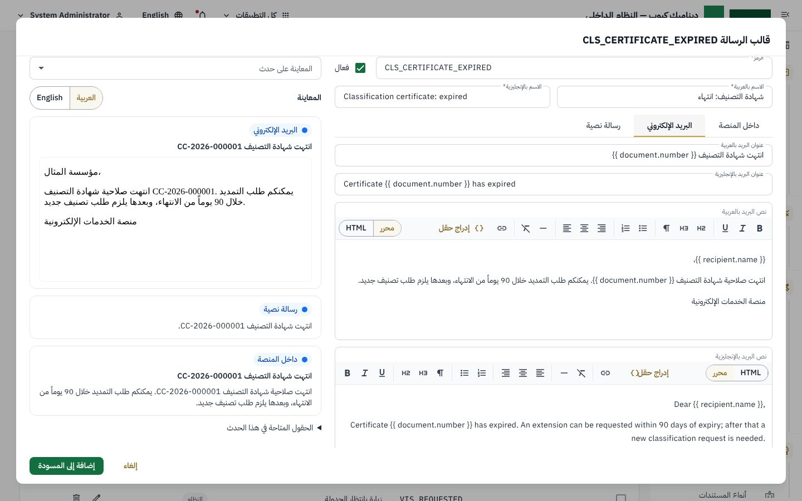

*محرر قالب الرسالة مع المعاينة*

## 12. المدفوعات

«مزودو الدفع» يحددون طريقة إصدار الفواتير (مثل سداد) ومدة صلاحيتها وحقول إشعار السداد. الأسرار (المفاتيح) لا تُخزن في الشاشة بل في مخزن الأسرار باسمها.

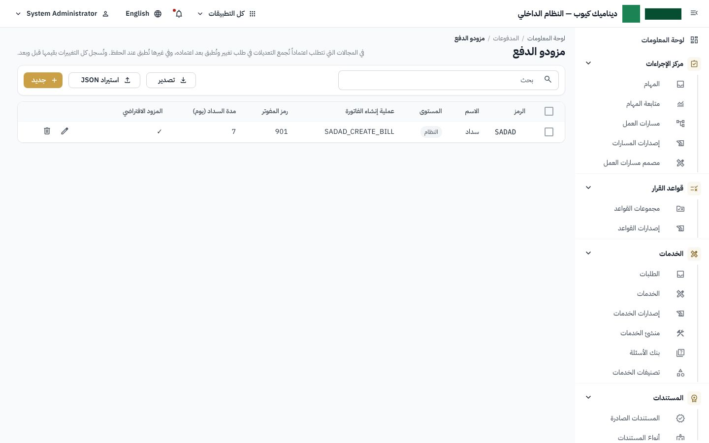

*مزودو الدفع*

## 13. الزيارات الميدانية

يحدد «نوع الزيارة» من يجريها (ميدانية، جهة معاينة خارجية، تسجيل يدوي)، والنتائج الممكنة، وحقول المفتش، وعدد الصور والتوقيع والموقع المطلوبة، وإعداد التكامل مع الجهة الخارجية.

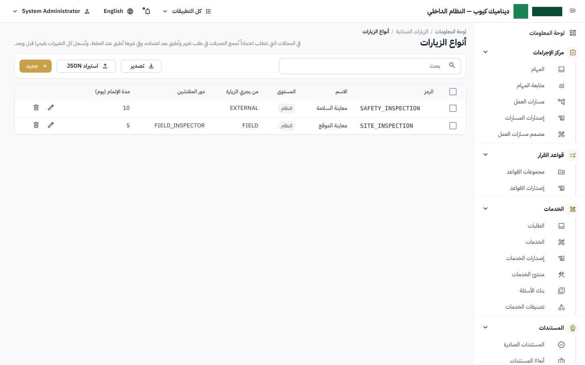

*أنواع الزيارات*

## 14. محتوى البوابة

يدير «محتوى البوابة» الصفحة الرئيسية (العنوان والصورة والإحصاءات والروابط)، والأسئلة الشائعة، والصفحات، وآراء الزوار.

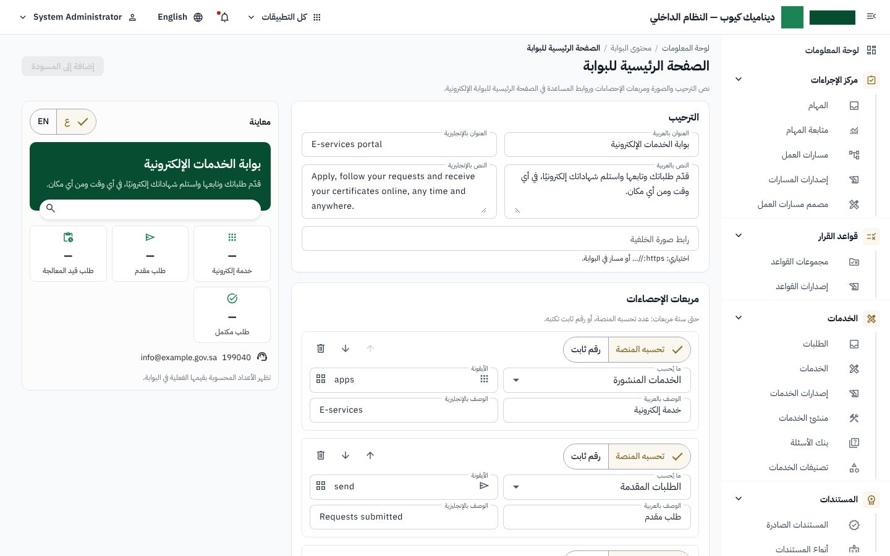

*الصفحة الرئيسية للبوابة*

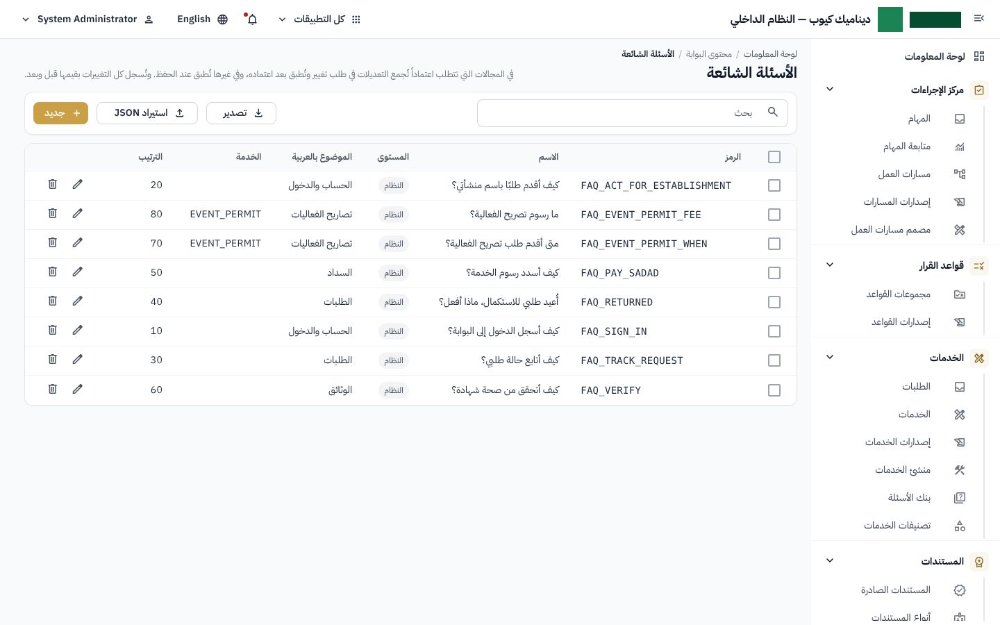

*الأسئلة الشائعة*

## 15. التكاملات

تربط التكاملات المنصة بالجهات الأخرى (السجل التجاري، النفاذ الوطني، سداد…):

- الجهات المزودة والاتصالات: عنوان الخدمة وطريقة المصادقة والمهلة وإعادة المحاولة.
- العمليات: المدخلات (الاسم والموقع وقيمة تجريبية) والمخرجات (الاسم والمسار في الاستجابة) ورموز الاستجابة.
- تجربة العمليات: استدعاء عملية بقيم تجريبية ومشاهدة النتيجة.
- سجل الاستدعاءات: كل استدعاء مع زمنه ونتيجته، مع إخفاء الحقول الحساسة.

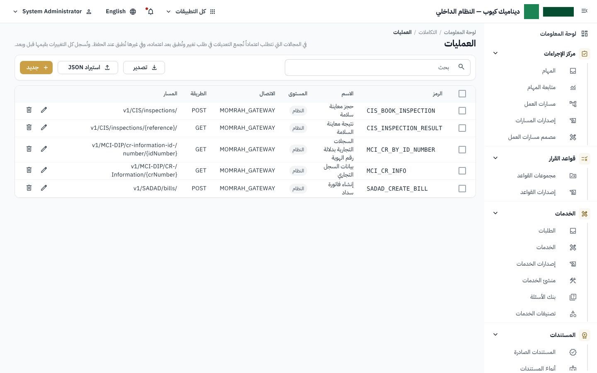

*العمليات*

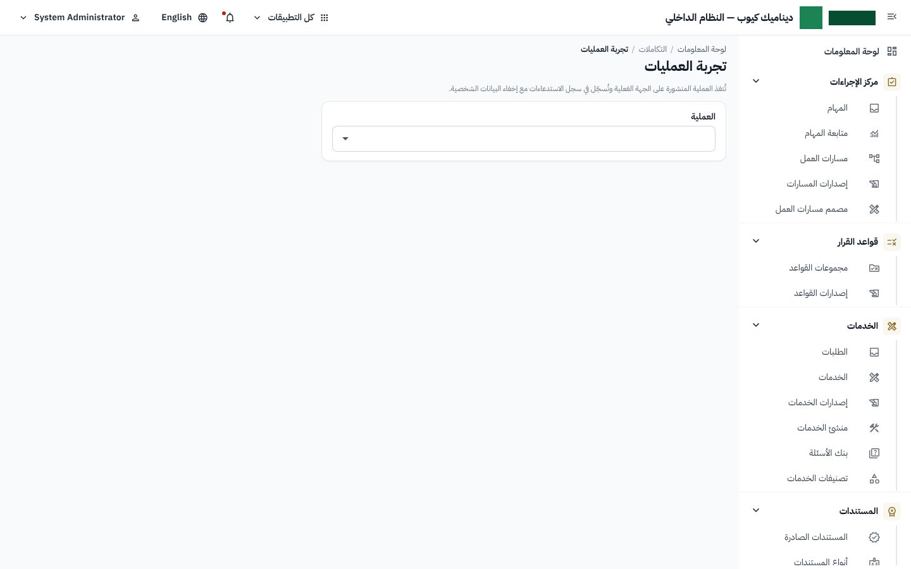

*تجربة العمليات*

## 16. التحكم بالتطبيقات

### 16.1 التصنيفات والقيم

التصنيف (Class) قائمة قيم لها خصائص (نص، رقم، تاريخ، نعم/لا، مرجع لتصنيف آخر، JSON)، والقيمة (Domain) عنصر فيها. كل قوائم النظام تُدار هنا: المناطق والمدن، وتصنيفات الخدمات، وأنواع العلاقات والشهادات والجزاءات، وأنواع خطوات المسار، وطرق التوزيع، وقنوات التنبيه وغيرها.

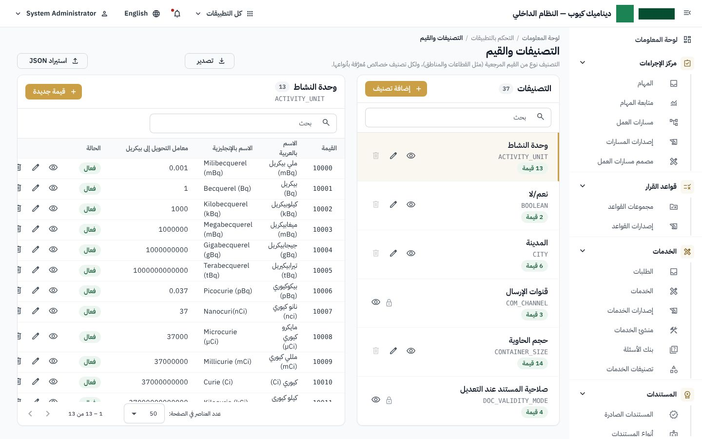

*التصنيفات والقيم*

> **ملاحظة:** تصنيفات النظام (المالك: النظام) لا يُغيَّر رمزها ولا خصائصها، لكن يمكن تعديل أسماء قيمها وترتيبها وإيقافها وإضافة قيم جديدة.

### 16.2 قوائم القيم

قائمة القيم مصدر لخيارات القوائم المنسدلة (من تصنيف أو جدول بيانات)، وتُربط بحقول الشاشات، وتُقيّد قيمها لكل دور.

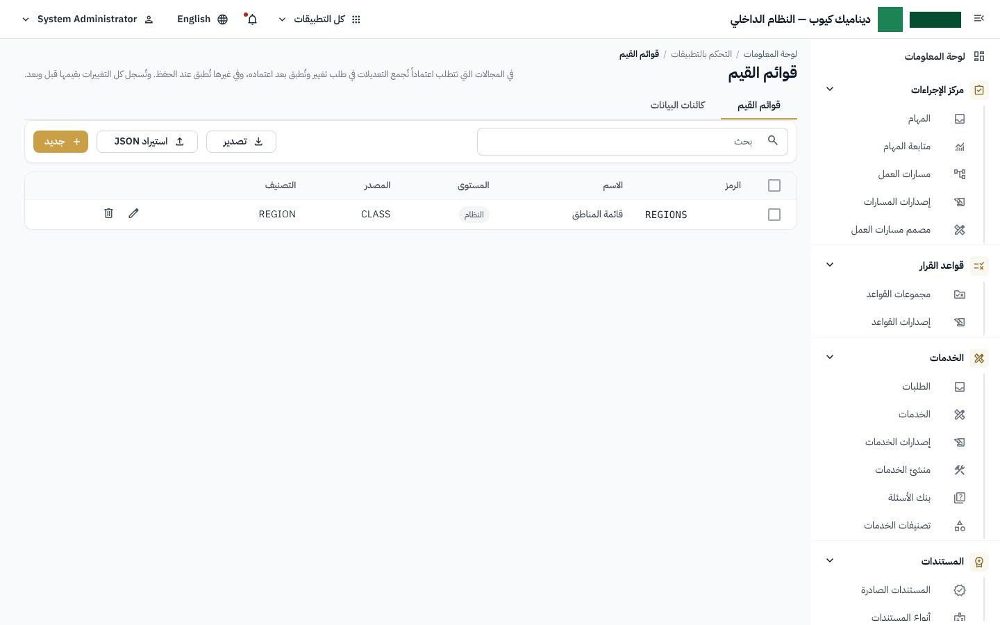

*قوائم القيم*

### 16.3 الهيكل التنظيمي

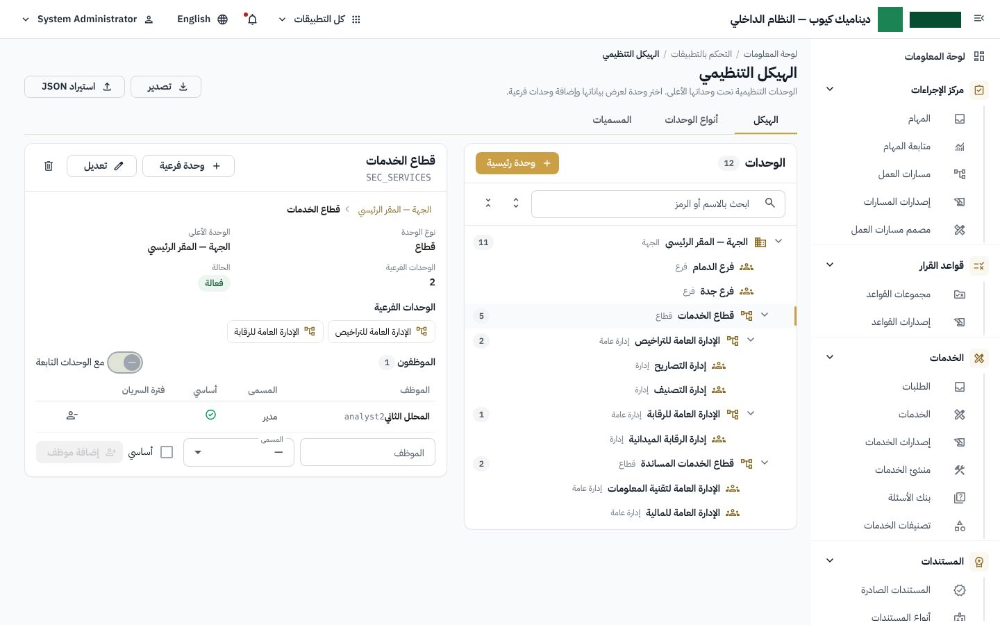

*الهيكل التنظيمي: الوحدة وموظفوها*

- الوحدات: شجرة الجهة؛ اختر وحدة لعرض بياناتها ووحداتها الفرعية، وأضف وحدة فرعية أو عدّلها أو انقلها.
- الموظفون: يعرض الجدول أسفل الوحدة الموظفين المعينين فيها ومسمياتهم، ومع «مع الوحدات التابعة» موظفي ما تحتها. أضف موظفًا بمسمى أو أزله من الوحدة.
- أنواع الوحدات: مستوى الوحدة في الهيكل (قطاع، إدارة عامة، إدارة، قسم، فرع)، وما يتبع كل نوع، وتستخدمها قواعد التوجيه.
- المسميات: الوظائف داخل الوحدة (مدير إدارة، رئيس قسم، محلل، مفتش)، لتوجيه المهام إلى «مدير الإدارة» دون تسمية شخص.

### 16.4 المستخدمون

أضف الموظف، وعيّن أدواره، وتكليفاته (الوحدة والمسمى)، وجهته. يُدار حساب الدخول (التفعيل وكلمة المرور) من الشاشة نفسها ما لم يكن الدخول موحدًا مع دليل الجهة.

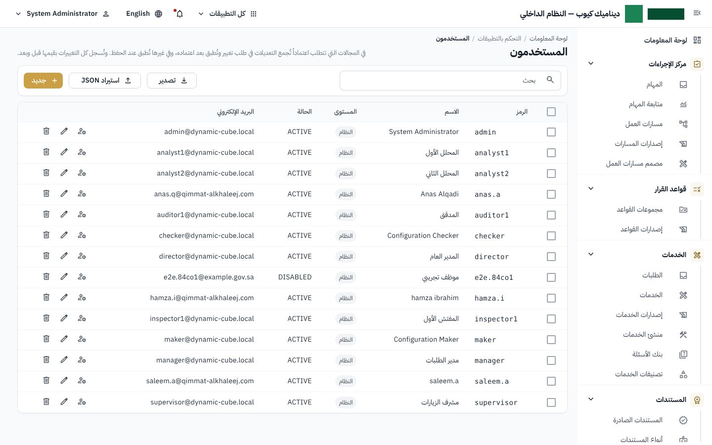

*المستخدمون*

### 16.5 الأدوار والصلاحيات

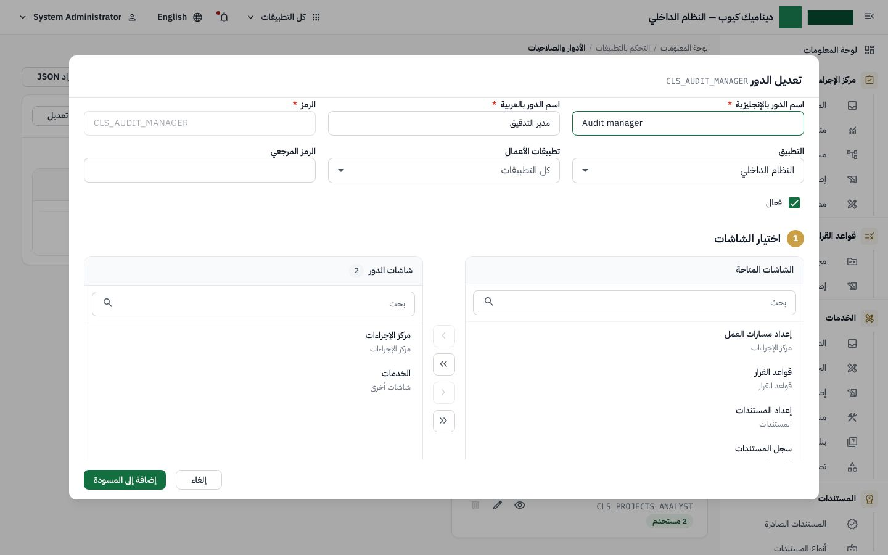

*محرر الدور*

1. البيانات: الاسم والرمز وتطبيقات الأعمال (دور واحد قد يخدم أكثر من تطبيق).
2. الشاشات: اختر الشاشات التي يفتحها الدور.
3. الإجراءات: لكل شاشة حدد الإجراءات (فتح، إضافة، تعديل، حذف، اعتماد، تصدير، طباعة) وما بداخلها.
4. البيانات في القوائم: لكل قائمة في الشاشة: الكل، أو قيم محددة، أو حسب قاعدة، أو لا شيء.
5. القوائم: عناصر القائمة الجانبية التي يظهرها الدور.

### 16.6 القوائم والإعدادات والهوية

- القوائم: مجموعات القائمة الجانبية وعناصرها وأيقوناتها وترتيبها.
- الإعدادات: قيم عامة مثل التقويم وأيام العطلة.
- النظام والجهة: الجهات وتطبيقات الأعمال.
- الهوية والشعار: الاسم والشعار وألوان النظام والبوابة وصور الدخول وبيانات التواصل.

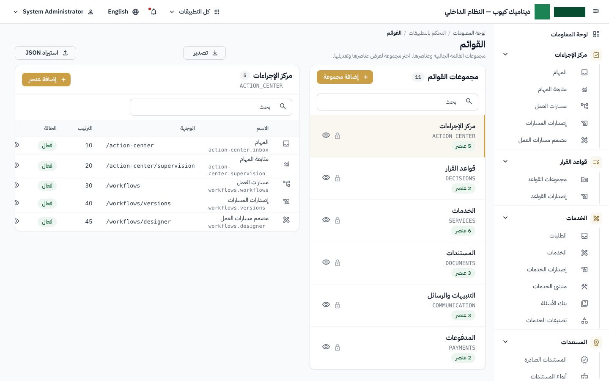

*القوائم*

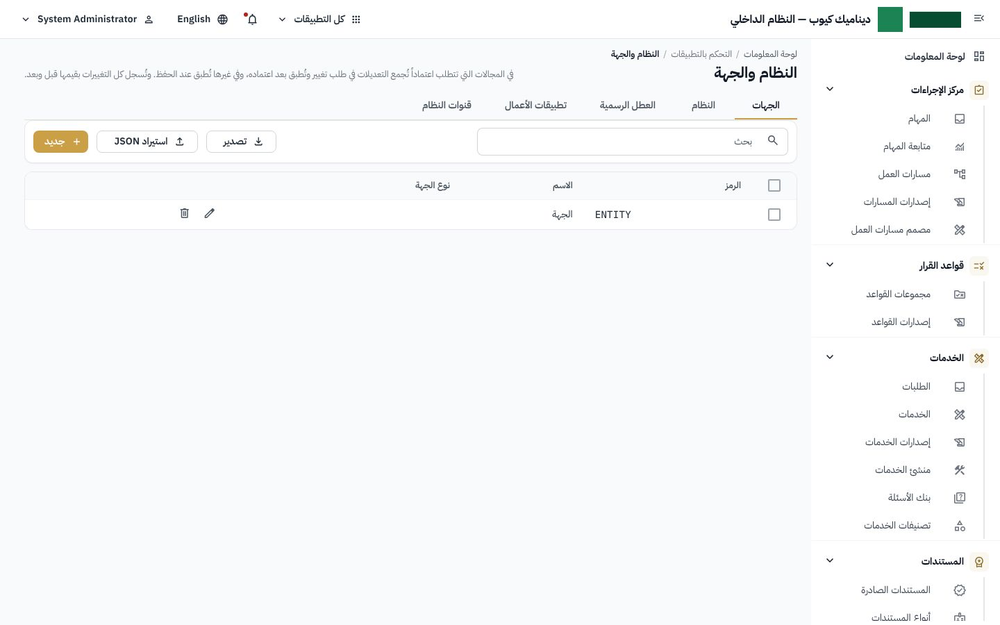

*النظام والجهة: الجهات وتطبيقات الأعمال*

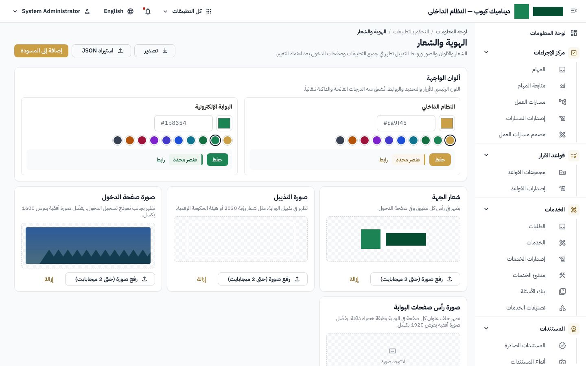

*الهوية والشعار*

## 17. أسئلة شائعة

| المشكلة | الحل |
| --- | --- |
| حفظت تعديلًا ولم يظهر | المجال يتطلب اعتمادًا: أرسل المسودة من «طلبات التغيير» واطلب اعتمادها. |
| لا تظهر شاشة أو زر | الصلاحية غير ممنوحة لدورك، أو لم يُضف العنصر إلى قوائم دورك. راجع مسؤول الصلاحيات. |
| لا أرى طلبات تطبيق آخر | تحقق من اختيار التطبيق في الشريط العلوي، ومن تطبيقات أدوارك. |
| المهمة لا تظهر في «مهامي» | قد تكون في «المهام المتاحة» تنتظر الاستلام، أو في «للتوزيع». |
| خطأ عند الاستيراد | تعرض نافذة المراجعة البند والحقل وسبب الخطأ؛ صحح الملف وأعد الفحص. |

## مسرد المصطلحات

| المصطلح | المعنى |
| --- | --- |
| طلب تغيير | مجموعة تعديلات على الإعداد تُعتمد وتُنشر معًا. |
| تطبيق أعمال | خط أعمال في الجهة له خدماته وموظفوه (مثل التصنيف). |
| مسار العمل | خطوات معالجة طلب الخدمة ومن ينفذها. |
| إصدار | نسخة منشورة لا تتغير من خدمة أو مسار أو مجموعة قواعد. |
| التصنيف والقيمة | قائمة قيم وعناصرها (Class / Domain). |
| قائمة القيم | مصدر خيارات قائمة منسدلة مع تقييد قيمها لكل دور. |
| JSONLogic | صيغة لكتابة الشروط والقواعد، مثل `{"==": [{"var": "data.city"}, "RIYADH"]}`. |

