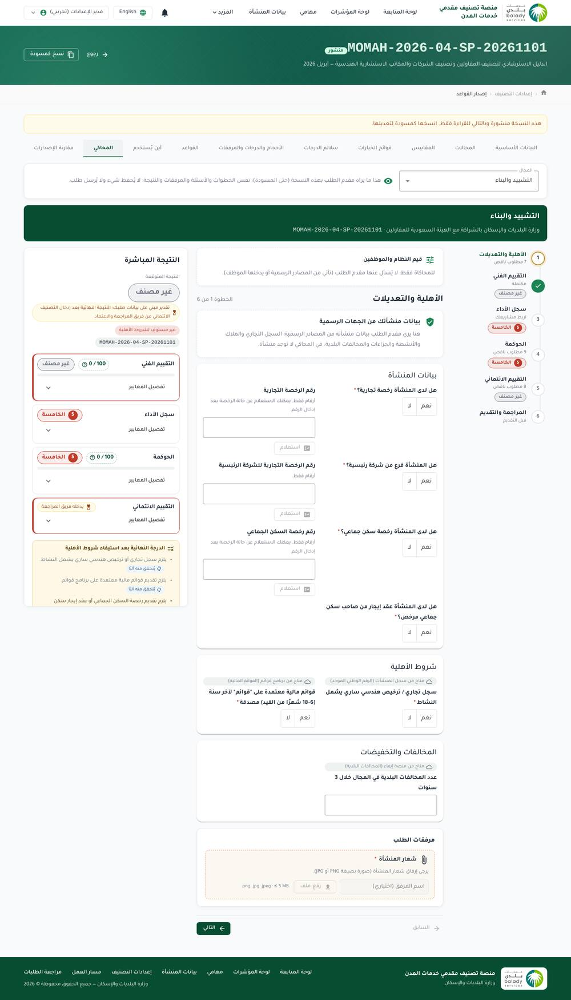
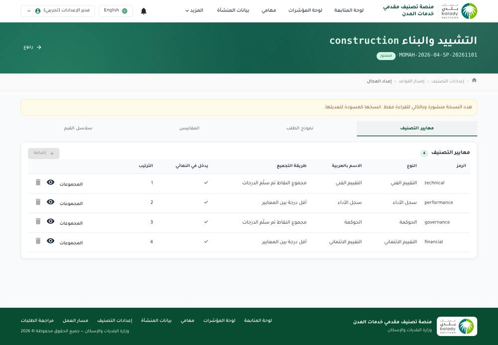
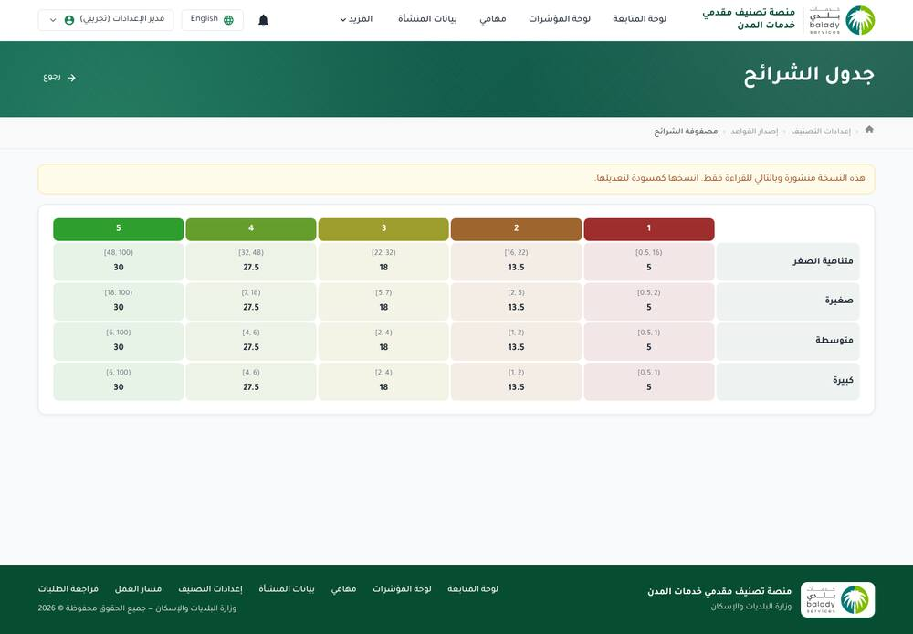
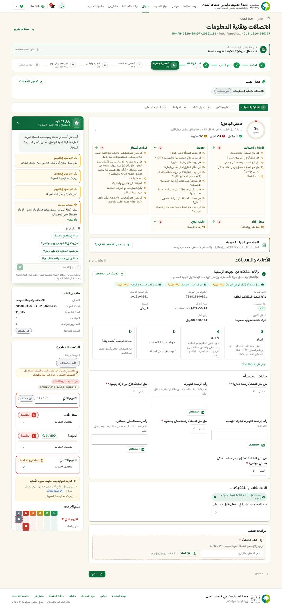
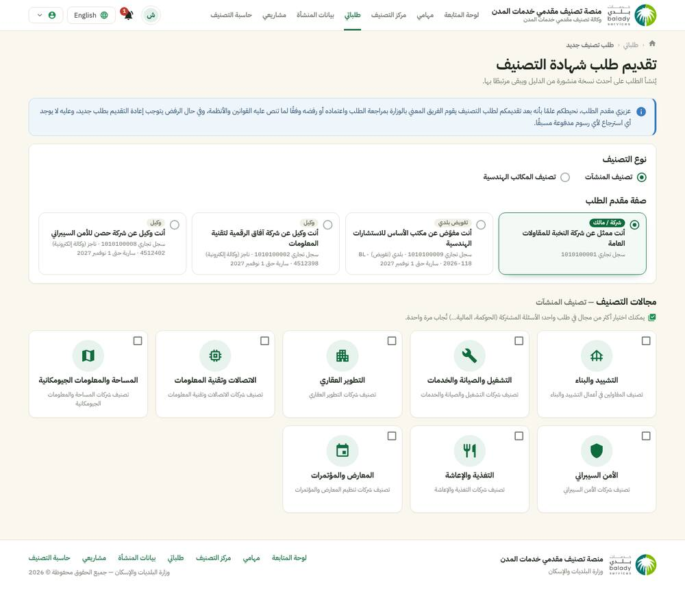
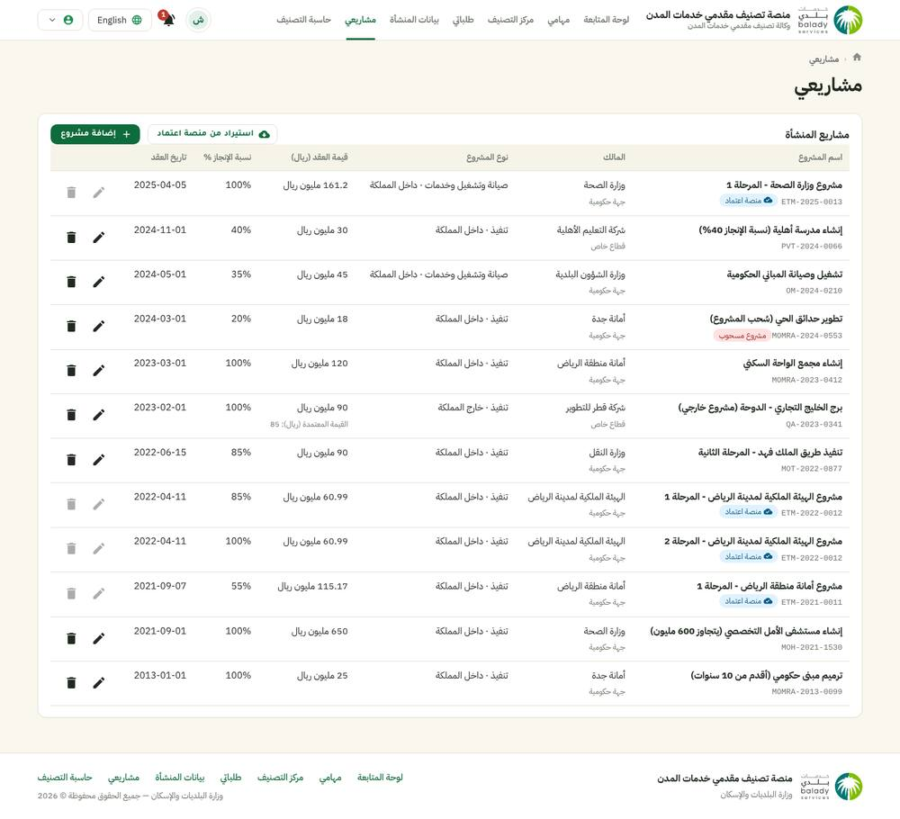
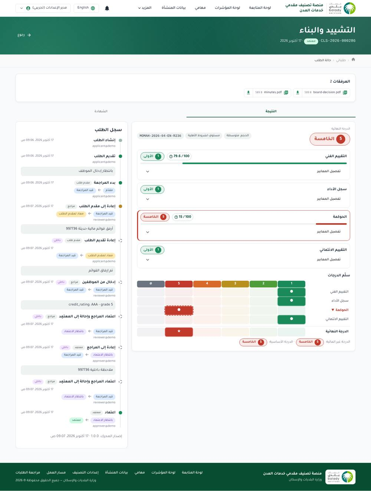
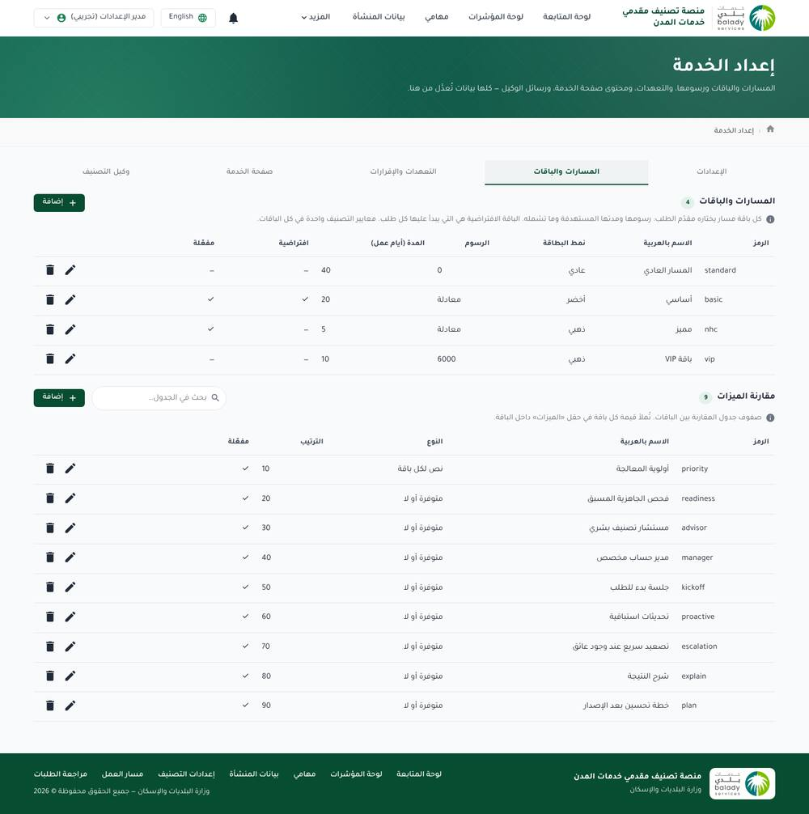
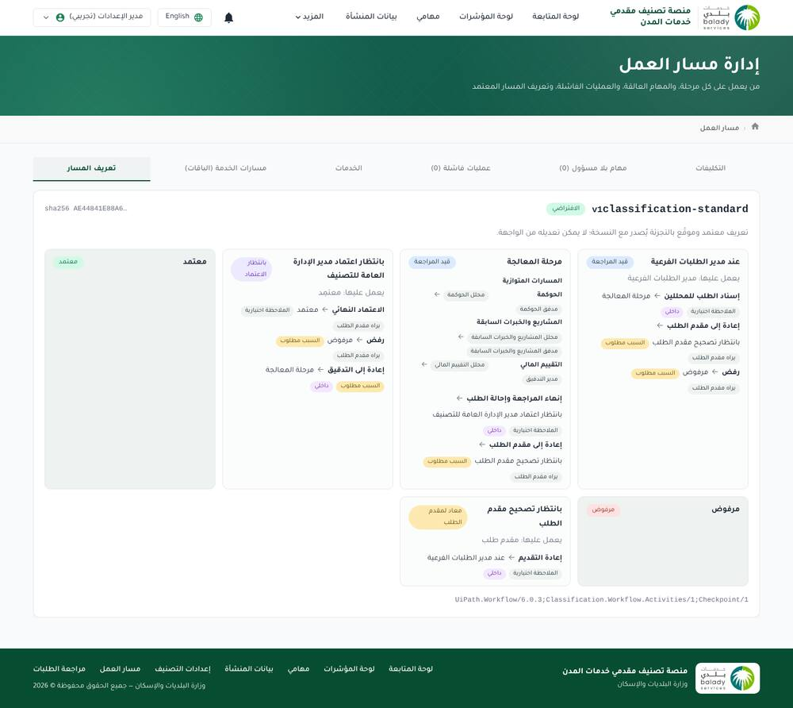

# Review: the NHCI classification system, and building it on Dynamic Cube

**Date:** 2 November 2026 · **Reviewed:** the internal system (`nhci-internal.gbstechnology.net`, as the configuration
administrator) and the applicant portal (`nhci.gbstechnology.net`, as an applicant), both demo instances.
**Method:** every menu screen and its tabs opened in a browser, the data each screen loads read from its API, and the
engine's own simulator run with sample values. Look only: nothing was saved, submitted or changed (all writes were
blocked; only sign-in and the simulator, which saves nothing, were allowed). Rule set reviewed: the published
**MOMAH-2026-04-SP-20261101** — *Contractor & Engineering Consultancy Classification Guide, April 2026*.

**Short answer.** Yes, Dynamic Cube can carry this system. About two thirds is already there as configuration (portal,
request journey, workflow with parallel reviews, roles, integrations, documents and QR, notifications, reports and
dashboards, side panel with live result). The missing third is the **classification engine itself**, plus a few service
features it needs (repeating rows such as projects, staff inputs during review, one request covering several sectors,
packages with a fee formula). The engine fits exactly where Dynamic Cube already expects it: a decision engine behind the
platform's decision contract ([ADR-0014](../adr/0014-pluggable-decision-engine.md)). ADR-0020 already says that band
tables, the financial axis and the adjusters belong in such a dedicated engine.

---

## 1. What the system is

A single-purpose platform for one service, *classification of city service providers* (Ministry of Municipalities and
Housing): an applicant asks for a grade (1 best … 5) in one or more **sectors**. Each sector's grade comes from scored
**tracks** (technical, performance, governance, financial). Staff review and approve the result, and a certificate is
issued.

- **9 sectors:** construction, ICT, O&M and services, real estate development, catering, exhibitions, surveying, cyber
  security, engineering offices. Each has its supervising authority (Saudi Contractors Authority, DGA, GEOSA, NCA, SCE…).
- **Two classification kinds:** establishments, and engineering offices.

## 2. The classification engine

### 2.1 What a rule set holds

A rule set version (draft → published → archived; a published version is read-only and is changed by **cloning it as a
draft**) holds:

| Part | In the reviewed version | Notes |
|---|---|---|
| **Metrics** (the facts) | 88 | Type (integer, decimal, money, percent, years, option, yes/no, text, table), unit, min/max, who enters it (applicant, system, staff), where it comes from: **input**, **derived** (formula such as `IIF([total_employees] > 0, [engineers] / [total_employees] * 100, null)`), **system** aggregates over the firm's projects (`PROJECTS_SUM(value_sar_m)`, `PROJECTS_MAX`, `PROJECTS_COUNT(cond)`, `PROJECTS_DISTINCT`), or an **external provider field** (Qawaem, registry, authority, Ifaa, credit), with "locked" and "allow override" flags. |
| **Option sets** | 21 | Answer lists with an ordinal, e.g. governance answers, credit ratings AAA…CCC. |
| **Size categories** | 4 | Micro 1–5, small 6–49, medium 50–499, large 500+ employees, by the size metric `total_employees`. |
| **Grades** | 5 | G1 (best) … G5. |
| **Grade scales** | 4 | Points → grade, e.g. technical: ≥70 → 1, 50–70 → 2, 40–50 → 3, 30–40 → 4, 20–30 → 5, <20 → not graded. |
| **Sectors** | 9 | Enabled flag, authority, certificate scope, an activity floor (ICT). |
| **Tracks** per sector | 4 | Type and **aggregation**: *sum to scale* (points summed, then the scale), *worst grade* (worst criterion grade), or **custom** (a coded handler). Included in the final grade or not, optional weight. |
| **Groups** per track | 1–2 | Max points, **mandatory** (a minimum must be met). |
| **Criteria** per group | 1–11 | A metric; scoring by **bands** or by **options**; output **points** or a **grade**; source value or option ordinal; max points; an **applicability** condition (`[engineers] > 0`). |
| **Bands** per criterion | 5 per size category (20 rows), or 5 | Ranges (min/max, inclusive or not) → points or grade rank, a display max and label. Ranges differ per company size and can rise and fall (value-added jobs peak at 25–55%). |
| **Eligibility gates** | 4 | Condition + Arabic/English message, blocking or not, for all sectors or some (valid CR or license, Qawaem statements, housing license or lease, commercial license). |
| **Adjustments** | 2 | Condition → effect (demote by N grades), for all sectors or the current one (withdrawn government projects; 70+ municipal violations). |
| **Project rules** | 4 | Which projects count: by type and location, minimum completion %, maximum age, minimum value, certified value for foreign projects. A project split threshold (600 M SAR). |
| **Attachment types and rules** | 21 / 14 | Required or optional, per application or per project, by condition, single or several files, by track. |
| **Form sections and fields** | 11 sections, 42–51 fields per sector | The applicant form is generated from the metrics: section, order, required, visibility and required-when conditions, track. |
| **Activities** | ICT only | Activity levels with minimum scores (RDI, IIS, SS, SD chain). |

### 2.2 How it calculates (confirmed with the simulator)

1. **Values** are resolved: answers, official data, derived formulas, project aggregates (only projects that pass the
   project rules), staff inputs.
2. **Size category** from total employees, which picks the band row for every size-dependent criterion.
3. **Gates:** any failed blocking gate makes the request not eligible; messages say why.
4. **Each track:** each applicable criterion finds its band or option, giving points or a grade. Groups add up points
   and check their minimum. *Sum to scale* tracks map the total through their scale; *worst grade* tracks take their
   worst criterion. ICT's technical track runs the coded `IctCategory` handler (platinum/gold/silver/beginner with an
   R&D condition and an activity chain).
5. **Non-financial grade** = the worst grade of the included tracks; tracks pulling it down are marked *limiting*.
6. **Financial track** waits for the staff input (credit rating), then the **base grade**.
7. **Adjustments** demote the grade, giving the **final grade**. An *expected grade* is shown while inputs are pending.

Simulator run (construction, 60 employees → *medium*): technical 89.9/100 → **1**; performance (95 M cumulative, 25 M
largest) → **2**; governance 80/100 → **2**; non-financial grade **2**; financial *waiting for staff*. The result explains
every criterion: input, band, points, why a criterion did not apply.

### 2.3 Tools around the engine

- **Simulator:** shows the version exactly as the applicant would see it (steps, questions, attachments, live result)
  and lets the administrator set system and staff values. It saves nothing.
- **Version compare**, **where used** (metrics and their uses, unused ones), **clone as draft**, **import JSON**.
- **Grade ladder** on results: a grid of tracks × grades with the limiting track marked.

## 3. The service around it

### 3.1 Applicant portal

- **Classification centre:** the firm's card (from official sources), grades per sector, requests in progress, links to
  each result and certificate. **Dashboard** with request counts by status and sector.
- **New request:** classification kind; **who is applying**: the firm's owner or representative, a **Balady
  authorization** for another firm, or a **Najiz e-agency** (each with its number and expiry); **several sectors in one
  request** (shared questions such as governance are asked once).
- **Request wizard:** service → scope → **path and package** → **readiness check** (completion %, missing and
  conditional items per track) → attachments → **pledges** → review and fees → tracking. The track steps come from the
  rule set. Official data is shown read-only with its source and date (registry, owners, activities, Ifaa violations,
  certificate penalties), with "refresh from sources". Licence numbers have an **inquiry** button.
- **Side panel:** the **classification agent** (stage messages by condition, Q&A, "why"), a request summary, the **live
  result** with the expected grade, per-track scores and the grade ladder.
- **My projects:** the firm's projects (owner, type, value, completion, dates, withdrawn), **imported from Etimad** or
  added by hand, linked to requests.
- **Calculator:** estimates a grade for any sector, starting from the firm's latest data.

### 3.2 Internal system

- **Review page:** one result per sector, the workflow position, current task and its owner, **staff inputs** (the
  credit rating, fetched from S&P by the financial analyst at their step), *save and evaluate again*, the application
  data, projects, activities, attachments, an **integration evidence log** (every external call with its payload and
  reference), the history.
- **Workflow:** requests manager → **processing in three parallel lanes** (governance, projects, financial; each analyst
  then auditor, with returns to the manager or the previous step) → approver → certificate; returns to the applicant.
  The definition is **shipped with the release** (UiPath Workflow runtime, signed with a hash) and **cannot be changed
  from the screens**. Admin tabs: assignments, unowned tasks, failed commands, services, paths (packages), definition.
- **Packages:** standard (inactive), basic, premium and VIP. Each has an SLA in days, features (priority, advisor,
  account manager…), a **fee formula** (`([credit_fin_total_assets] + [credit_fin_total_income]) * 0.0005`, min 3,000,
  max 175,000 SAR) or a fixed fee, and a *recommend when* condition.
- **Automation rules:** assign unowned tasks to the least-loaded user, remind after 48 h, escalate after 96 h, early
  reminder for urgent requests, rebalance heavy loads. Each rule has a condition, a test console, a log and "run now".
- **Also:** notification templates (9, by event and audience), lists of values (31), lookups, roles and screens (12
  roles, 30 screens, an access matrix with screen parts), users, change log, **8 external integrations**, service page
  facts, pledges, the assistant's content, **performance analytics** (9 tabs: executive summary, requests, tracks,
  certificates, this month, change requests, complaints, complaint analysis, common issues), and dashboards and data.

## 4. Findings

### Strong points worth keeping
- A **complete and general engine model**: metrics, sizes, bands, gates, adjustments, project rules and attachments are
  data, versioned together, so a new guide edition is a new version, not code.
- **Explainability:** per-criterion input, band, points and reason. Limiting tracks, the grade ladder and the expected
  grade while staff inputs are pending.
- **The simulator** shows the applicant's exact journey for a draft version before it is published.
- **Evidence:** every external value keeps its source, time, reference and payload.
- **Applicant experience:** readiness, assistant, live result, several sectors per request, acting for another firm by
  authorization or agency, projects imported from Etimad.

### Issues and risks seen
1. **Workflow cannot be configured.** The stages, lanes and actions ship with the release. Any change to the review
   process is a code release.
2. **Sector logic in code.** ICT's technical track is a coded handler (`IctCategory`) driven by a JSON blob, not by the
   screens. Other authorities with special rules would need more code.
3. **Conditions are text formulas** (`[gov_board] == 'yes'`, `PROJECTS_COUNT(is_withdrawn && …)`) typed by the
   administrator. Mistakes surface only when evaluated.
4. **Roles without screens:** in *Roles and screens setup*, the analyst, auditor and requests-manager roles show **0 of 30
   screens**, while the workflow gives them tasks. This needs checking: they may not be able to open the review page.
5. **Wording mismatch on a result:** request CLS-2026-000286's history says *"credit_rating: AAA - grade 5"*. The credit
   bands map AAA to grade 1, and the result shows the financial track at grade 1.
6. **Drafts pile up:** the demo firm has 184 drafts out of 236 requests, several open at once for the same sector. There
   is no "one open draft per sector" guard.
7. **Version noise:** 322 rule set versions are listed (clones, drafts, archived). There is no clean-up or filtering by
   status in the list.
8. **All 8 integrations are stubs** (registry, Qawaem, authority, Etimad, Ifaa, credit, licences, penalties). Their real
   contracts are still to be proven.
9. **Sign-in:** its own e-mail/password sign-in, with the session token kept in browser storage. A production version
   should use the national single sign-on (Nafath) and an identity provider.

## 5. Can Dynamic Cube build it?

| Feature | Dynamic Cube today | Work needed |
|---|---|---|
| Portal: services catalogue, service page facts, request wizard, drafts, autosave, tracking | ✅ Services + portal | Configuration |
| Applicant acts for a firm (owner, delegate) | ✅ Establishment links and relationship types (ADR-0035) | Add *Balady authorization* and *Najiz agency* as relationship types with number and expiry; check them through integration steps |
| Official data shown read-only with source; inquiry buttons; refresh | ✅ Integration steps, question fill, locked answers, draft refresh (ADR-0037/0038) | Configuration (8 connections, now mocks) |
| Generated form per sector from the rule set | ⚠️ Forms come from the Service Builder | The engine exposes its metrics as **questions** (a question bank source), so the builder lays them out. Or the form is generated from the engine's sections |
| Readiness check, assistant, summary, live result, grade ladder | ✅ Side panel (ADR-0040) | Point the live result at the new engine; show per-track results |
| Attachment rules by condition, per project | ✅ File questions with conditions (ADR-0034) | Per-row (per project) attachments, with repeating rows |
| **Repeating rows** (projects, withdrawn projects) | ❌ No table answer type | **New:** a repeating-group question type |
| **Firm projects registry** with Etimad import, linked to requests | ❌ | **New:** a project list on the party (establishment), filled from an Etimad operation or by hand |
| **Several sectors in one request**, one result each | ⚠️ Bundled requests (ADR-0046) give one request per sector | Decide: keep bundles (simplest), or one request with a result per sector |
| Packages: SLA, features, fee formula with min/max, recommend when | ⚠️ Fees and JSONLogic amounts exist; payments via SADAD | **Extend:** service paths/packages, chosen by the applicant, setting SLA and fee |
| Pledges | ✅ Yes/no questions | Configuration |
| Workflow: manager → 3 parallel analyst/auditor lanes → approver; returns | ✅ Designer with split/join, maker-checker, returns (ADR-0019/0023) | Configuration. **Better than the reviewed system:** editable without a release |
| **Staff inputs during review** (credit rating at the financial step), re-evaluate | ❌ Tasks have actions and comments, not fields | **New:** task fields that write facts, then re-run the decision step |
| Distribution least-loaded, SLA reminders and escalation | ✅ Distribution, SLA monitor, escalation | Generic "automation rules" (condition → assign/remind/escalate with a log) would be an extension |
| Certificate with QR verify, validity 24 months | ✅ Documents module | Configuration (template exists in the NHC demo) |
| Notifications by event and audience | ✅ Communication | Configuration |
| Roles, screens, access matrix, users | ✅ Apps Control | Configuration |
| Change log / maker-checker on configuration | ✅ Change sets | — |
| Lists of values, lookups | ✅ Class/Domain, LOVs, query builder | Configuration |
| Performance analytics and dashboards | ✅ Reports, charts, dashboards, drill-down | Configuration. Complaints and change-request datasets need those services first |
| Public calculator | ⚠️ The decision contract already allows anonymous evaluation of public rule sets | A calculator page on the portal |
| Integration evidence per request | ✅ Integration call log | Show it on the request page |
| **The classification engine** (§2) | ❌ Built-in engine is JSONLogic rule sets only | **New:** engine plug-in (below) |

## 6. Proposed approach

**A configurable classification engine as a Decisions engine** (ADR-0014 contract: rule set code and version, input
mapping, output mapping, explanation trace, stateless, usable by the public calculator). Its configuration follows the
platform's rules: versioned, saved through change sets, exportable as packages.

1. **CE-1 Engine and its data:** rule set version tree as in §2.1, the evaluation in §2.2 with the full explanation,
   expressions in JSONLogic (the platform's language, with the visual editor), and project aggregates as functions.
   Make the ICT case **configurable** (category thresholds, R&D condition, activity chain) instead of a coded handler.
   Golden tests: the reviewed simulator results become fixed test cases.
2. **CE-2 Engine screens:** rule set designer (sectors → tracks → groups → criteria → bands per size), scales, gates,
   adjustments, project rules, **simulator**, version compare, where used. Plus an **importer** for the reviewed system's
   rule set export, so the April 2026 guide does not have to be typed again.
3. **CE-3 Service features:** repeating-group questions, the firm projects registry with Etimad import, per-row
   attachments, metrics offered to the Service Builder as questions.
4. **CE-4 Review features:** task fields (staff inputs) that update facts and re-run the decision, packages with SLA and
   fee formula, per-sector results on the request page, the grade ladder.
5. **CE-5 Rebuild the NHC demo** on it: the 9 sectors, the workflow with its three lanes, packages, calculator,
   dashboards.

### Decisions for you
1. **Several sectors:** one request per sector tied together (bundles, already built), or one request with a result per
   sector (closer to the reviewed system)?
2. **Special sector rules (ICT):** make them configurable (recommended), or allow a small coded plug-in per authority?
3. **Expressions:** convert their `[metric]` formulas to JSONLogic on import (recommended, one language and the visual
   editor), or support their syntax as a second language?
4. **Start point:** CE-1 + CE-2 first (engine, screens, import), then the service features. Or the service features first
   with today's JSONLogic rule sets?
